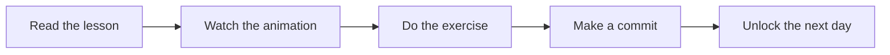

## 👋 About

Hi, I'm **Rutuja Naik**. Git Quest is my public learning series where every day is a short, playful lesson. The repo itself is the lesson: every commit you see here is a real example of the concept being taught.

Follow along from Day 1 and by Day 30 you will be comfortable with branches, merges, pull requests, rebasing, GitHub Actions and more.

> **Meet Commit the Cat 🐱**, the mascot who explains each day with analogies, diagrams and animations.

## 🧭 How it works

Each day follows the same simple structure:

| File | What's inside |
|------|---------------|
| `README.md` | A 5-minute lesson with an analogy |
| `demo.gif` / diagram | An animation or Mermaid diagram of the concept |
| `exercise.md` | A small challenge to try yourself |



## 🗺️ Quest map

### Week 1: First Steps 🐣
| Day | Topic | Status |
|-----|-------|--------|
| 1 | [What is Git vs GitHub?](./day01-intro) | ✅ Done |
| 2 | `git init` and your first commit | 🔒 Coming soon |
| 3 | The 3 areas: working, staging, repository | 🔒 Coming soon |
| 4 | `git add` and good commit messages | 🔒 Coming soon |
| 5 | `git log` (your time machine) | 🔒 Coming soon |
| 6 | `git diff` (spot the difference) | 🔒 Coming soon |
| 7 | Week 1 recap, quiz and cheat sheet | 🔒 Coming soon |

### Week 2: Undo and Branch 🌿
| Day | Topic | Status |
|-----|-------|--------|
| 8 | `.gitignore` | 🔒 Coming soon |
| 9 | `git restore` and `git reset` | 🔒 Coming soon |
| 10 | `git commit --amend` | 🔒 Coming soon |
| 11 | What is a branch? | 🔒 Coming soon |
| 12 | `git switch` and `git branch` | 🔒 Coming soon |
| 13 | `git merge` | 🔒 Coming soon |
| 14 | Week 2 recap: Branch Adventure | 🔒 Coming soon |

### Week 3: GitHub Superpowers 🚀
| Day | Topic | Status |
|-----|-------|--------|
| 15 | Remotes and `git push` | 🔒 Coming soon |
| 16 | `git clone` | 🔒 Coming soon |
| 17 | `git fetch` vs `git pull` | 🔒 Coming soon |
| 18 | Merge conflicts | 🔒 Coming soon |
| 19 | Forks | 🔒 Coming soon |
| 20 | Pull requests | 🔒 Coming soon |
| 21 | Week 3 recap: make a PR | 🔒 Coming soon |

### Week 4: Level Up 🏆
| Day | Topic | Status |
|-----|-------|--------|
| 22 | `git stash` | 🔒 Coming soon |
| 23 | `git rebase` (beginner-safe) | 🔒 Coming soon |
| 24 | `git cherry-pick` | 🔒 Coming soon |
| 25 | Tags and releases | 🔒 Coming soon |
| 26 | `git reflog` (rescue deleted work) | 🔒 Coming soon |
| 27 | Issues and Projects boards | 🔒 Coming soon |
| 28 | GitHub Actions: your first workflow | 🔒 Coming soon |
| 29 | GitHub Pages or a profile README | 🔒 Coming soon |
| 30 | Finale: full cheat sheet and what's next | 🔒 Coming soon |

## 📂 Repository structure

```text
git-quest/
├── README.md            <- you are here
├── day01-intro/
│   ├── README.md
│   └── exercise.md
├── day02-first-commit/
├── ...
└── day30-finale/
```

## 📝 Commit message style

This repo uses [Conventional Commits](https://www.conventionalcommits.org/), which is also a good habit to learn early:

| Prefix | Use it for | Example |
|--------|-----------|---------|
| `docs:` | Lessons and documentation | `docs(day01): add intro lesson on Git vs GitHub` |
| `feat:` | Something new, like an animation | `feat(day01): add animated header to README` |
| `chore:` | Housekeeping and progress updates | `chore(day01): add exercise and progress tracker` |

## 🚀 Start here

1. Create a free account on [github.com](https://github.com).
2. Install Git from [git-scm.com](https://git-scm.com).
3. Check it works:
   ```bash
   git --version
   ```
4. Tell Git who you are:
   ```bash
   git config --global user.name "Your Name"
   git config --global user.email "you@example.com"
   ```
5. Open [Day 1](./day01-intro) and begin your quest!

## 🤝 Join in

- ⭐ **Star** the repo to follow the series.
- 🍴 **Fork** it and make your own commits as you learn.
- 💬 Open an **issue** if something is unclear. Your question will help the next learner too.

## 👩‍💻 Author

**Rutuja Naik**, learning Git in public, one commit a day.

---

<p align="center"><i>Git saves your work. GitHub shares it. Happy committing! 🐱</i></p>
