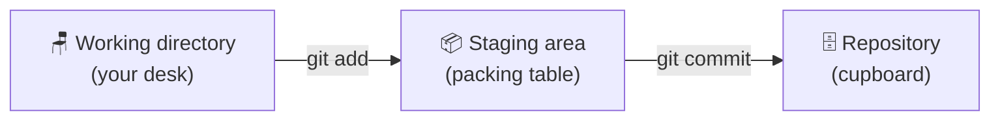

# 🗂️ Day 3: The 3 Areas of Git


> **Yesterday:** you made your first commit with `git add` and `git commit`.
> **Today:** you learn *where* your files are while that happens. This one idea makes the rest of Git easy.

---

## 🎯 Today's mission

By the end of this lesson you will be able to:

- Name the **3 areas** of Git: working directory, staging area, repository
- Move a file from one area to the next with `git add` and `git commit`
- Read `git status` like a traffic light
- Pack only some of your files into a commit

## 🐱 The analogy: desk, packing table, cupboard

Imagine you are sending a parcel.

| Area | Real name | The analogy | What lives here |
|------|-----------|-------------|-----------------|
| 1️⃣ | **Working directory** | 🪑 Your desk | Files you are creating and editing right now |
| 2️⃣ | **Staging area** (also called the *index*) | 📦 The packing table | Files you picked for the next save |
| 3️⃣ | **Repository** (the `.git` folder) | 🗄️ The cupboard | Sealed save points (commits), kept forever |



> 💡 **Why a packing table at all?** It lets you choose *exactly* what goes into each save point. You can change 5 files but commit only 2, so every commit tells one clear story.

## 🛠️ Step by step

Work inside the `my-first-repo` folder from Day 2 (or make a new repo with `git init -b main`).

### Step 1: Put two new files on your desk

```bash
echo "Milk, eggs" > shopping.txt
echo "Project ideas" > notes.txt
```

### Step 2: See where they are

```bash
git status
```

```text
On branch main
Untracked files:
  (use "git add <file>..." to include in what will be committed)
        notes.txt
        shopping.txt

nothing added to commit but untracked files present (use "git add" to track)
```

Both files are on the **desk**. Git sees them but is not tracking them yet.

### Step 3: Move ONE file to the packing table

```bash
git add shopping.txt
git status
```

```text
On branch main
Changes to be committed:
  (use "git restore --staged <file>..." to unstage)
        new file:   shopping.txt

Untracked files:
  (use "git add <file>..." to include in what will be committed)
        notes.txt
```

`shopping.txt` is now **staged** (on the packing table). `notes.txt` stayed on the desk.

### Step 4: Seal it into the cupboard

```bash
git commit -m "Add shopping list"
```

```text
[main 8c1d4e7] Add shopping list
 1 file changed, 1 insertion(+)
 create mode 100644 shopping.txt
```

### Step 5: Check again

```bash
git status
```

```text
On branch main
Untracked files:
  (use "git add <file>..." to include in what will be committed)
        notes.txt

nothing added to commit but untracked files present (use "git add" to track)
```

Only `notes.txt` is left on the desk. Your commit contains *just* the shopping list. 🎉

### Step 6: Edit a tracked file

```bash
echo "Bread" >> shopping.txt
git status
```

```text
Changes not staged for commit:
  (use "git add <file>..." to update what will be committed)
  (use "git restore <file>..." to discard changes in working directory)
        modified:   shopping.txt
```

The file is back on the desk with new changes. Run `git add` and `git commit` again to save them.

## 🚦 Read `git status` like a traffic light

| Git says | Color | Meaning |
|----------|-------|---------|
| `Untracked files` | 🔴 | A new file Git isn't watching yet (on the desk) |
| `Changes not staged for commit` | 🔴 | An edited file that is still on the desk |
| `Changes to be committed` | 🟢 | Packed and waiting on the packing table |
| `nothing to commit, working tree clean` | 🔵 | Everything is safely in the cupboard |

## 🎬 Watch it happen


> Generated from [`demo.tape`](./demo.tape) using [VHS](https://github.com/charmbracelet/vhs).

## 🧰 Cheat sheet

| Command | What it does |
|---------|--------------|
| `git status` | Shows which area each file is in |
| `git add <file>` | Desk → packing table |
| `git add .` | Pack every changed file at once |
| `git commit -m "message"` | Packing table → cupboard |
| `git restore --staged <file>` | Take a file back off the packing table |

## 🆘 Common problems

| You see | What it means | Fix |
|---------|---------------|-----|
| `nothing added to commit` | You ran `git commit` but nothing was staged | Run `git add <file>` first |
| File missing from the commit | You forgot to stage it | `git add <file>`, then `git commit --amend` (Day 10) |
| Packed the wrong file | It's on the packing table by mistake | `git restore --staged <file>` |

## ✅ Your turn

Head to [`exercise.md`](./exercise.md) and practice moving files between the areas.

---

⬅️ [Day 2: git init and your first commit](../day02-first-commit) | ➡️ **Day 4: git add and writing good commit messages** *(coming tomorrow)*
