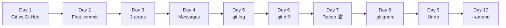
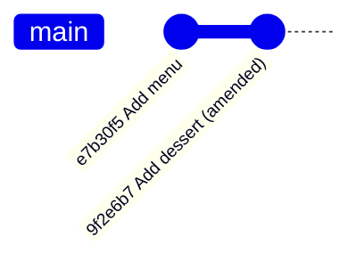

# 🎮 Git Quest: Days 1 to 10 at a Glance

**Created by Rutuja Naik**

Double digits! Ten days in, you can create repositories, write clear commits, read your history, ignore junk, undo mistakes and now **fix your last commit**. This page recaps every day so far and explains Day 10 in detail.

## 🗺️ The journey so far



| Day | Topic | One-line takeaway | Key commands |
|-----|-------|-------------------|--------------|
| 1 | Git vs GitHub | Git saves your work. GitHub shares it. | `git --version`, `git config` |
| 2 | `git init` and your first commit | `git init` opens a save slot; a commit is a save point. | `git init`, `git status`, `git commit` |
| 3 | The 3 areas of Git | Desk, packing table, cupboard. | `git add`, `git commit`, `git restore --staged` |
| 4 | `git add` and good commit messages | A message is the label on the box. | `git add .`, `git commit -m "summary" -m "body"` |
| 5 | `git log`, your time machine | `HEAD` means "you are here". | `git log --oneline`, `git show` |
| 6 | `git diff`, spot the difference | Red pen = removed, green pen = added. | `git diff`, `--staged`, `HEAD~1 HEAD` |
| 7 | Week 1 recap | Put it all together. | The daily loop |
| 8 | `.gitignore` | A "do not pack" list. | `.gitignore`, `git rm --cached` |
| 9 | `git restore` and `git reset` | Pick the right undo. | `git restore`, `git reset --soft / --mixed / --hard` |
| 10 | `git commit --amend` | Reopen the last box: fix its label or add a forgotten item. | `git commit --amend -m`, `--no-edit` |

## ✏️ Day 10 in detail: `git commit --amend`

### The idea

You sealed a box and stuck on a label, then spotted a typo, or realised you forgot to pack one item. You do not need a whole new box. You **reopen the last box**, fix it and seal it again.

`git commit --amend` replaces your **most recent commit** with a corrected one.



> 🔎 **Under the hood:** Git does not edit the old commit. It builds a **new** commit with a **new hash** and abandons the old one. That is why amending shows a different ID in `git log`.

### Three ways to use it

| You want to... | Command |
|----------------|---------|
| Fix the message | `git commit --amend -m "Add menu"` |
| Add a forgotten file | `git add dessert.txt` then `git commit --amend --no-edit` |
| Fix a small mistake in a file | Edit the file, `git add <file>`, then `git commit --amend --no-edit` |

`--no-edit` means "keep the existing message".

### Hands-on

```bash
git init -b main amend-lab && cd amend-lab
echo "Pasta" > menu.txt
git add menu.txt && git commit -m "Add mnu"      # oops, typo!
git log --oneline
# a41c9d2 (HEAD -> main) Add mnu

git commit --amend -m "Add menu"                 # A. fix the message
git log --oneline
# e7b30f5 (HEAD -> main) Add menu                # new hash!

echo "Dessert" >> menu.txt
git add menu.txt && git commit -m "Add dessert to menu"
echo "Dessert recipe" > dessert.txt              # forgot this one...
git add dessert.txt
git commit --amend --no-edit                     # B. sneak it into the same commit
git show --stat                                  # both files, one commit
```

### ⚠️ The golden rule

**Only amend commits that you have NOT shared.** Once a commit has been pushed to GitHub (Week 3), other people may already have it. Rewriting it creates confusion. If a commit is already shared, make a new commit instead.

### 🛟 Good to know

- Amend only works on the **last** commit. Older ones need tools you will meet later.
- If an editor opens (often Vim), press `Esc`, type `:wq` and press `Enter`. Using `-m` or `--no-edit` avoids it.
- Amend vs reset: `git reset --soft HEAD~1` then `git commit` gives the same result in two steps. Amend is the shortcut.
- The old commit is not instantly gone: `git reflog` (Day 26) can still find it.

## 🧰 Combined cheat sheet (Days 1 to 10)

| Command | What it does | Day |
|---------|--------------|-----|
| `git init -b main` | Creates a repository | 2 |
| `git status` | Which area is each file in? | 2, 3 |
| `git add <file>` / `git add .` | Desk → packing table | 2 to 4 |
| `git commit -m "message"` | Packing table → cupboard | 2 to 4 |
| `git log --oneline` / `git show <hash>` | Read your history | 5 |
| `git diff` / `git diff --staged` | Compare desk, table, cupboard | 6 |
| `git rm --cached <file>` | Stop tracking a file | 8 |
| `git restore --staged <file>` | Packing table → desk | 3, 9 |
| `git restore <file>` | Discard edits ⚠️ | 9 |
| `git reset --soft / --hard HEAD~1` | Undo a commit | 9 |
| `git commit --amend -m "msg"` | Fix the last commit's message | 10 |
| `git commit --amend --no-edit` | Add staged changes to the last commit | 10 |

## 🧠 Day 10 mini quiz

1. Which flag keeps the old message when you amend?
2. Does amend edit the old commit or create a new one?
3. When should you never amend a commit?

<details>
<summary>👀 Click to see the answers</summary>

1. `--no-edit`
2. It creates a new commit with a new hash and abandons the old one.
3. After the commit has been shared (pushed).

</details>

## ✅ Skills unlocked so far

- [x] Everything from Week 1 (repos, the 3 areas, commits, log, diff)
- [x] Write a `.gitignore` and stop tracking files
- [x] Unstage, discard and reset safely
- [x] Fix a commit message after the fact
- [x] Add a forgotten file to the last commit

## 🔜 Coming up in Week 2: Undo and Branch 🌿

| Day | Topic |
|-----|-------|
| 11 | What is a branch? |
| 12 | `git switch` and `git branch` |
| 13 | `git merge` |
| 14 | Week 2 recap: Branch Adventure |

## 📌 Your Day 10 commit

| File | Message |
|------|---------|
| `days-1-to-10-summary.md` | `docs(day10): add days 1-10 summary and amend notes` |

---

<p align="center"><i>Progress: 10 / 30 days complete. Double digits! 🐱</i></p>
