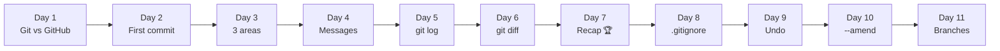
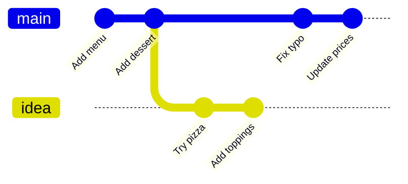

# 🎮 Git Quest: Days 1 to 11 at a Glance

**Created by Rutuja Naik**

Today you met one of the biggest ideas in Git: the **branch**. Good news: after everything you already know, it is simpler than it sounds. This page recaps every day so far and explains Day 11 in detail.

## 🗺️ The journey so far



| Day | Topic | One-line takeaway | Key commands |
|-----|-------|-------------------|--------------|
| 1 | Git vs GitHub | Git saves your work. GitHub shares it. | `git --version`, `git config` |
| 2 | `git init` and your first commit | A commit is a save point. | `git init`, `git status`, `git commit` |
| 3 | The 3 areas of Git | Desk, packing table, cupboard. | `git add`, `git commit`, `git restore --staged` |
| 4 | `git add` and good commit messages | A message is the label on the box. | `git add .`, `git commit -m "summary" -m "body"` |
| 5 | `git log`, your time machine | `HEAD` means "you are here". | `git log --oneline`, `git show` |
| 6 | `git diff`, spot the difference | Red pen = removed, green pen = added. | `git diff`, `--staged` |
| 7 | Week 1 recap | Put it all together. | The daily loop |
| 8 | `.gitignore` | A "do not pack" list. | `.gitignore`, `git rm --cached` |
| 9 | `git restore` and `git reset` | Pick the right undo. | `git restore`, `git reset --soft / --hard` |
| 10 | `git commit --amend` | Reopen the last box. | `git commit --amend --no-edit` |
| 11 | What is a branch? | A branch is a movable sticky note on a commit. | `git branch`, `git log --decorate` |

## 🌿 Day 11 in detail: what is a branch?

### The problem

So far you have had **one timeline**: every commit comes after the previous one. What if you want to try a risky idea (say, a pizza section on your menu) without messing up the version that works?

### The idea

A **branch** is a separate line of work. Think of it as a **parallel timeline**, or a spare save slot for experiments. If the experiment goes wrong, your main timeline is untouched. If it goes well, you bring it back with a **merge** (Day 13).



### The secret: a branch is just a sticky note 📌

A branch is **not a copy of your files**. It is only a tiny **movable label** that points at one commit.

| Word | What it really is |
|------|-------------------|
| **Branch** | A sticky note stuck on a commit. When you commit, the note moves forward to the new commit. |
| **`main`** | The default branch: the first sticky note, created by `git init -b main`. |
| **`HEAD`** | The "you are here" pin. It points at the branch you are currently on. `HEAD -> main` means "I am on main". |

Because a branch is only a label, creating one is **instant and costs almost nothing**.

### Why use branches?

| Reason | Example |
|--------|---------|
| 🧪 Try ideas safely | Test a new menu design without touching the working one |
| 🔀 Work in parallel | One branch for the dessert page, another for prices |
| 🛡️ Keep `main` stable | `main` always contains work you trust |
| 🤝 Collaborate | Each person works on their own branch (Week 3) |

### Hands-on: meet your first branch

```bash
git init -b main branch-lab && cd branch-lab
echo "Pasta" > menu.txt && git add menu.txt
git commit -m "Add menu"
echo "Dessert" >> menu.txt && git add menu.txt
git commit -m "Add dessert"

git branch
# * main                          <- the only branch; * marks where you are

git log --oneline --decorate
# c3d9e41 (HEAD -> main) Add dessert
# 8a1f2b6 Add menu

git branch idea                   # stick a NEW label on the same commit
git log --oneline --decorate
# c3d9e41 (HEAD -> main, idea) Add dessert    <- two labels, one commit
# 8a1f2b6 Add menu

git branch -d idea                # tidy up: remove the label
# Deleted branch idea (was c3d9e41).
```

Notice that `HEAD -> main` did not change: creating a branch does **not** move you onto it. **Tomorrow (Day 12)** you will learn `git switch` to jump between branches and make commits on them.

## 🧰 Combined cheat sheet (Days 1 to 11)

| Command | What it does | Day |
|---------|--------------|-----|
| `git init -b main` | Creates a repository | 2 |
| `git status` | Which area is each file in? | 2, 3 |
| `git add <file>` / `git add .` | Desk → packing table | 2 to 4 |
| `git commit -m "message"` | Packing table → cupboard | 2 to 4 |
| `git log --oneline` / `git show <hash>` | Read your history | 5 |
| `git diff` / `git diff --staged` | Compare desk, table, cupboard | 6 |
| `git rm --cached <file>` | Stop tracking a file | 8 |
| `git restore` / `git reset` | Undo edits, staging or commits | 9 |
| `git commit --amend` | Fix the last commit | 10 |
| `git branch` | List branches (`*` = current) | 11 |
| `git branch <name>` | Make a new branch label (you stay put) | 11 |
| `git branch -d <name>` | Delete a branch label | 11 |
| `git log --oneline --decorate` | Show branch labels on commits | 11 |

## 🧠 Day 11 mini quiz

1. What is a branch, really?
2. What does `HEAD -> main` mean?
3. Give two reasons to use branches.

<details>
<summary>👀 Click to see the answers</summary>

1. A movable label (pointer) that sits on one commit. It is not a copy of your files.
2. You are currently on the `main` branch.
3. Try ideas safely; work in parallel; keep `main` stable; collaborate without getting in each other's way.

</details>

## ✅ Skills unlocked so far

- [x] Everything from Week 1 (repos, the 3 areas, commits, log, diff)
- [x] `.gitignore`, undo tools and `--amend`
- [x] Explain what a branch is in plain words
- [x] Read `HEAD -> main` in the log
- [x] List, create and delete a branch label

## 🔜 Coming up in Week 2: Undo and Branch 🌿

| Day | Topic |
|-----|-------|
| 12 | `git switch` and `git branch`: move between branches |
| 13 | `git merge`: bring work back together |
| 14 | Week 2 recap: Branch Adventure |

## 📌 Your Day 11 commit

| File | Message |
|------|---------|
| `days-1-to-11-summary.md` | `docs(day11): add days 1-11 summary and branch notes` |

---

<p align="center"><i>Progress: 11 / 30 days complete. Branching out! 🐱</i></p>
