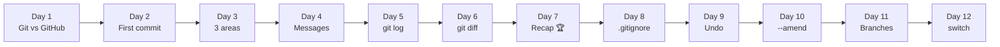
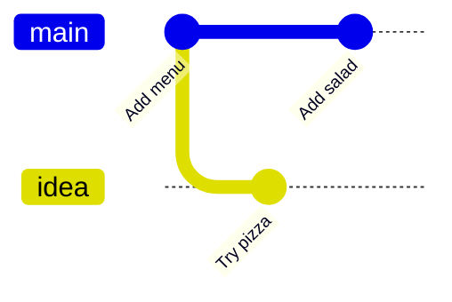

# 🎮 Git Quest: Days 1 to 12 at a Glance

**Created by Rutuja Naik**

Yesterday you learned that a branch is a sticky note on a commit. Today you learned to **jump between branches** and watch your files change as you do. This page recaps every day so far and explains Day 12 in detail.

## 🗺️ The journey so far



| Day | Topic | One-line takeaway | Key commands |
|-----|-------|-------------------|--------------|
| 1 | Git vs GitHub | Git saves your work. GitHub shares it. | `git --version`, `git config` |
| 2 | `git init` and your first commit | A commit is a save point. | `git init`, `git status`, `git commit` |
| 3 | The 3 areas of Git | Desk, packing table, cupboard. | `git add`, `git commit`, `git restore --staged` |
| 4 | `git add` and good commit messages | A message is the label on the box. | `git add .`, `git commit -m "summary" -m "body"` |
| 5 | `git log`, your time machine | `HEAD` means "you are here". | `git log --oneline`, `git show` |
| 6 | `git diff`, spot the difference | Red pen = removed, green pen = added. | `git diff`, `--staged` |
| 7 | Week 1 recap | Put it all together. | The daily loop |
| 8 | `.gitignore` | A "do not pack" list. | `.gitignore`, `git rm --cached` |
| 9 | `git restore` and `git reset` | Pick the right undo. | `git restore`, `git reset --soft / --hard` |
| 10 | `git commit --amend` | Reopen the last box. | `git commit --amend --no-edit` |
| 11 | What is a branch? | A branch is a movable sticky note on a commit. | `git branch`, `git log --decorate` |
| 12 | `git switch` and `git branch` | Switching moves `HEAD` and swaps your files to match the branch. | `git switch`, `git switch -c`, `git branch` |

## 🔀 Day 12 in detail: switching between branches

### The idea

`git switch <name>` moves your **HEAD pin** to another branch, and Git rewrites the files in your folder so they match that branch's latest commit. Your project literally changes shape as you hop between timelines.



### The switch toolkit

| Command | What it does |
|---------|--------------|
| `git branch` | List branches. The `*` marks where you are. |
| `git switch <name>` | Move onto an existing branch. |
| `git switch -c <name>` | **C**reate a new branch and move onto it in one step. |
| `git switch -` | Jump back to the branch you were on before. |
| `git branch -v` | List branches with their latest commit. |
| `git branch -m <old> <new>` | Rename a branch. |
| `git branch -d <name>` | Delete a branch that is already merged (safe). |
| `git branch -D <name>` | Force-delete a branch, even if unmerged ⚠️ |

> 💡 You may see `git checkout <name>` in older tutorials. It does the same job (`git checkout -b` = `git switch -c`), but `git switch` is clearer, so we use it.

### Hands-on: watch your files change

```bash
git init -b main switch-lab && cd switch-lab
echo "Pasta" > menu.txt && git add menu.txt
git commit -m "Add menu"

git switch -c idea                    # Switched to a new branch 'idea'
git branch
# * idea
#   main

echo "Pizza" >> menu.txt && git add menu.txt
git commit -m "Try pizza"
cat menu.txt                          # Pasta, Pizza

git switch main                       # Switched to branch 'main'
cat menu.txt                          # Pasta  <- the pizza vanished!

git switch idea
cat menu.txt                          # Pasta, Pizza  <- and it's back!

git switch -                          # back to main
echo "Salad" >> menu.txt && git add menu.txt
git commit -m "Add salad"
git log --oneline --graph --all
# * 5c0f8a2 (HEAD -> main) Add salad
# | * 3e7a1c9 (idea) Try pizza
# |/
# * b84d2f0 Add menu
```

The last picture is a **fork**: `main` and `idea` have each moved on independently. Tomorrow (Day 13) you will bring them back together with `git merge`.

### 🛟 Good to know

- **Commit before you switch.** If you have unsaved changes that would be overwritten by the other branch, Git refuses to switch and asks you to commit first (or stash, Day 22).
- Each branch has its own history. A commit made on `idea` does not appear on `main` until you merge.
- `git branch -d idea` will refuse right now because `idea` is not merged yet. That is Git protecting your work.

## 🧰 Combined cheat sheet (Days 1 to 12)

| Command | What it does | Day |
|---------|--------------|-----|
| `git init -b main` | Creates a repository | 2 |
| `git status` | Which area is each file in? | 2, 3 |
| `git add <file>` / `git add .` | Desk → packing table | 2 to 4 |
| `git commit -m "message"` | Packing table → cupboard | 2 to 4 |
| `git log --oneline` / `git show <hash>` | Read your history | 5 |
| `git diff` / `git diff --staged` | Compare desk, table, cupboard | 6 |
| `git rm --cached <file>` | Stop tracking a file | 8 |
| `git restore` / `git reset` | Undo edits, staging or commits | 9 |
| `git commit --amend` | Fix the last commit | 10 |
| `git branch` / `git branch <name>` | List or create branch labels | 11, 12 |
| `git switch <name>` | Move onto a branch | 12 |
| `git switch -c <name>` | Create a branch and move onto it | 12 |
| `git switch -` | Back to the previous branch | 12 |
| `git log --oneline --graph --all` | Draw every branch | 11, 12 |

## 🧠 Day 12 mini quiz

1. Which command creates a branch **and** switches to it?
2. What happens to the files in your folder when you switch branches?
3. What does `git switch -` do?

<details>
<summary>👀 Click to see the answers</summary>

1. `git switch -c <name>`
2. They change to match the latest commit of the branch you moved to.
3. It takes you back to the branch you were on before.

</details>

## ✅ Skills unlocked so far

- [x] Everything from Week 1 (repos, the 3 areas, commits, log, diff)
- [x] `.gitignore`, undo tools and `--amend`
- [x] Explain what a branch is
- [x] Create a branch and switch between branches
- [x] Commit on a branch and see your files change
- [x] Read a fork with `git log --graph --all`

## 🔜 Coming up in Week 2: Undo and Branch 🌿

| Day | Topic |
|-----|-------|
| 13 | `git merge`: bring work back together |
| 14 | Week 2 recap: Branch Adventure |

## 📌 Your Day 12 commit

| File | Message |
|------|---------|
| `days-1-to-12-summary.md` | `docs(day12): add days 1-12 summary and switch notes` |

---

<p align="center"><i>Progress: 12 / 30 days complete. Branch hopper! 🐱</i></p>
