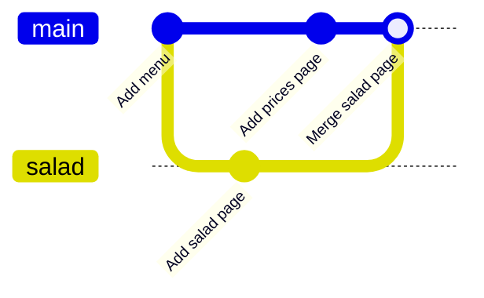

# 🎮 Git Quest: Days 1 to 13 at a Glance

**Created by Rutuja Naik**

Yesterday you learned to hop between branches. Today you learned how to **bring them back together** with `git merge`. This page recaps every day so far and explains Day 13 in detail.

## 🗺️ The journey so far

```mermaid
flowchart LR
  D1["Day 1<br/>Git vs GitHub"] --> D2["Day 2<br/>First commit"]
  D2 --> D3["Day 3<br/>3 areas"]
  D3 --> D4["Day 4<br/>Messages"]
  D4 --> D5["Day 5<br/>git log"]
  D5 --> D6["Day 6<br/>git diff"]
  D6 --> D7["Day 7<br/>Recap 🏆"]
  D7 --> D8["Day 8<br/>.gitignore"]
  D8 --> D9["Day 9<br/>Undo"]
  D9 --> D10["Day 10<br/>--amend"]
  D10 --> D11["Day 11<br/>Branches"]
  D11 --> D12["Day 12<br/>switch"]
  D12 --> D13["Day 13<br/>merge"]
```



| Day | Topic | One-line takeaway | Key commands |
|-----|-------|-------------------|--------------|
| 1 | Git vs GitHub | Git saves your work. GitHub shares it. | `git --version`, `git config` |
| 2 | `git init` and your first commit | A commit is a save point. | `git init`, `git status`, `git commit` |
| 3 | The 3 areas of Git | Desk, packing table, cupboard. | `git add`, `git commit`, `git restore --staged` |
| 4 | `git add` and good commit messages | A message is the label on the box. | `git add .`, `git commit -m "summary" -m "body"` |
| 5 | `git log`, your time machine | `HEAD` means "you are here". | `git log --oneline`, `git show` |
| 6 | `git diff`, spot the difference | Red pen = removed, green pen = added. | `git diff`, `--staged` |
| 7 | Week 1 recap | Put it all together. | The daily loop |
| 8 | `.gitignore` | A "do not pack" list. | `.gitignore`, `git rm --cached` |
| 9 | `git restore` and `git reset` | Pick the right undo. | `git restore`, `git reset --soft / --hard` |
| 10 | `git commit --amend` | Reopen the last box. | `git commit --amend --no-edit` |
| 11 | What is a branch? | A branch is a sticky note on a commit. | `git branch`, `git log --decorate` |
| 12 | `git switch` and `git branch` | Switching swaps your files to match the branch. | `git switch`, `git switch -c` |
| 13 | `git merge` | Bring a branch's work into another branch. | `git merge`, `git merge --abort` |

## 🔗 Day 13 in detail: `git merge`

### The idea

You tried an idea on its own branch and it worked. Now you want it in `main`. **Merging** joins two timelines back into one.

The golden rule: **stand on the branch that should RECEIVE the work**, then merge the other one in.

```bash
git switch main        # 1. stand on the receiving branch
git merge pizza        # 2. bring pizza INTO main
git branch -d pizza    # 3. tidy up the label
```

### Two kinds of merge

| | ⏩ Fast-forward | 🔀 True merge |
|---|----------------|---------------|
| **When** | `main` has not moved since you branched | Both branches have new commits |
| **What Git does** | Slides the `main` label forward | Creates a new **merge commit** with two parents |
| **New commit?** | No | Yes |
| **History shape** | A straight line | A diamond: two paths joining |



### Hands-on: both kinds

Each branch edits a **different file**, so nothing clashes.

```bash
git init -b main merge-lab && cd merge-lab
echo "Pasta" > menu.txt && git add . && git commit -m "Add menu"

# ⏩ Fast-forward
git switch -c pizza
echo "Pizza" > pizza.txt && git add . && git commit -m "Add pizza page"
git switch main
git merge pizza
# Updating b84d2f0..3e7a1c9
# Fast-forward
#  pizza.txt | 1 +
git branch -d pizza
# Deleted branch pizza (was 3e7a1c9).

# 🔀 True merge: move BOTH timelines first
git switch -c salad
echo "Salad" > salad.txt && git add . && git commit -m "Add salad page"
git switch main
echo "Prices" > prices.txt && git add . && git commit -m "Add prices page"

git merge salad -m "Merge salad page"
# Merge made by the 'ort' strategy.
#  salad.txt | 1 +

git log --oneline --graph
# *   a2c6e90 (HEAD -> main) Merge salad page
# |\
# | * 7d1f3b8 (salad) Add salad page
# * | 91e4c25 Add prices page
# |/
# * 3e7a1c9 Add pizza page
# * b84d2f0 Add menu
```

That diamond is the merge commit tying both timelines together.

### 🛟 Good to know

- **Direction matters.** `git merge salad` while on `main` brings salad **into** main. Salad itself does not change.
- **Editor popped up?** A true merge asks for a message. Add `-m "message"` (or `--no-edit`). If Vim opens: `Esc`, `:wq`, `Enter`.
- **Changed your mind?** `git merge --abort` cancels a merge that is still in progress.
- **Delete after merging.** `git branch -d` works once the branch is merged. It refuses on unmerged branches, which protects your work.
- **Coming on Day 18:** if both branches change the *same lines*, Git cannot decide for you. That is a *merge conflict*, and you will learn to fix it.

## 🧰 Combined cheat sheet (Days 1 to 13)

| Command | What it does | Day |
|---------|--------------|-----|
| `git init -b main` | Creates a repository | 2 |
| `git status` | Which area is each file in? | 2, 3 |
| `git add <file>` / `git add .` | Desk → packing table | 2 to 4 |
| `git commit -m "message"` | Packing table → cupboard | 2 to 4 |
| `git log --oneline --graph` | Read your history as a map | 5, 11 |
| `git diff` / `git diff --staged` | Compare desk, table, cupboard | 6 |
| `git restore` / `git reset` | Undo edits, staging or commits | 9 |
| `git commit --amend` | Fix the last commit | 10 |
| `git branch` / `git branch -d <name>` | List or delete branch labels | 11, 12, 13 |
| `git switch <name>` / `git switch -c <name>` | Move to or create a branch | 12 |
| `git merge <branch>` | Bring a branch into the one you are on | 13 |
| `git merge <branch> -m "msg"` | Merge with a message, no editor | 13 |
| `git merge --abort` | Cancel a merge in progress | 13 |

## 🧠 Day 13 mini quiz

1. Which branch should you be on when you run `git merge`?
2. What is a fast-forward merge?
3. How many parents does a true merge commit have?

<details>
<summary>👀 Click to see the answers</summary>

1. The branch that should **receive** the changes (usually `main`).
2. When `main` has not moved, Git just slides the label forward. No new commit is made.
3. Two.

</details>

## ✅ Skills unlocked so far

- [x] Everything from Week 1 (repos, the 3 areas, commits, log, diff)
- [x] `.gitignore`, undo tools and `--amend`
- [x] Create, switch between and delete branches
- [x] Merge a branch (fast-forward and true merge)
- [x] Read a merge in `git log --graph`

## 🔜 Coming up

| Day | Topic |
|-----|-------|
| 14 | Week 2 recap: Branch Adventure |
| 15 | Week 3 begins: remotes and `git push` |

## 📌 Your Day 13 commit

| File | Message |
|------|---------|
| `days-1-to-13-summary.md` | `docs(day13): add days 1-13 summary and merge notes` |

---

<p align="center"><i>Progress: 13 / 30 days complete. Timelines united! 🐱</i></p>
