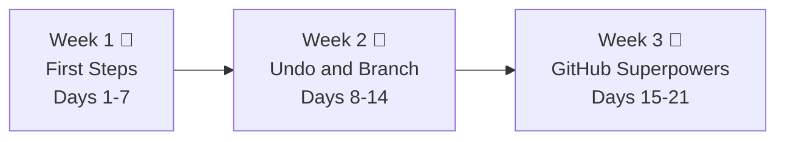
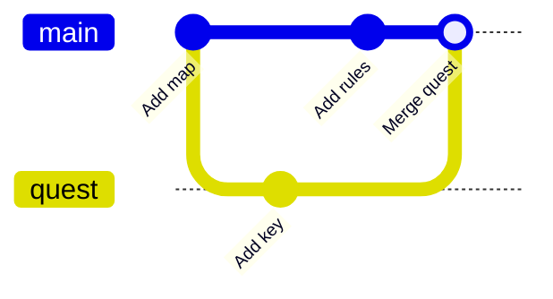

# 🏆 Git Quest: Week 2 Recap (Days 1 to 14)

**Created by Rutuja Naik**

Week 2 is complete! In two weeks you went from "What is Git?" to ignoring junk, undoing mistakes, fixing commits, and working with branches. This page recaps everything, with a cheat sheet, a quiz and a final quest.

## 🗺️ Your journey so far



| Day | Topic | One-line takeaway | Key commands |
|-----|-------|-------------------|--------------|
| 1 | Git vs GitHub | Git saves your work. GitHub shares it. | `git --version`, `git config` |
| 2 | `git init` and your first commit | A commit is a save point. | `git init`, `git status`, `git commit` |
| 3 | The 3 areas of Git | Desk, packing table, cupboard. | `git add`, `git commit`, `git restore --staged` |
| 4 | `git add` and good commit messages | A message is the label on the box. | `git add .`, `git commit -m "summary" -m "body"` |
| 5 | `git log`, your time machine | `HEAD` means "you are here". | `git log --oneline`, `git show` |
| 6 | `git diff`, spot the difference | Red pen = removed, green pen = added. | `git diff`, `--staged` |
| 7 | Week 1 recap | Put it all together. | The daily loop |
| 8 | `.gitignore` | A "do not pack" list. | `.gitignore`, `git rm --cached` |
| 9 | `git restore` and `git reset` | Pick the right undo. | `git restore`, `git reset --soft / --hard` |
| 10 | `git commit --amend` | Reopen the last box. | `git commit --amend --no-edit` |
| 11 | What is a branch? | A branch is a sticky note on a commit. | `git branch`, `git log --decorate` |
| 12 | `git switch` and `git branch` | Switching swaps your files to match the branch. | `git switch`, `git switch -c` |
| 13 | `git merge` | Join two timelines. | `git merge`, `git merge --abort` |
| 14 | Week 2 recap | Put the branching workflow together. | Everything above 🏆 |

## 📖 Week 2 in one page

### Day 8: `.gitignore`
A plain text file that lists patterns Git should skip: secrets, logs, build output, system junk. It only affects files Git is **not tracking yet**. Use `git rm --cached <file>` to stop tracking a committed file.

### Day 9: `git restore` and `git reset`
Undo moves things **backwards** through the 3 areas. `git restore --staged` unpacks safely. `git restore <file>` and `git reset --hard` **delete work** and cannot be undone for unsaved changes. `reset --soft` keeps changes staged, plain `reset` keeps them on the desk.

### Day 10: `git commit --amend`
Reopen the **last** commit to fix its message (`-m`) or add a forgotten file (`--no-edit`). It creates a **new** commit with a new hash. Never amend commits you have already shared.

### Day 11: What is a branch?
A branch is a **movable sticky note on a commit**, not a copy of your files. `main` is the default branch and `HEAD` is the "you are here" pin.

### Day 12: `git switch` and `git branch`
`git switch -c <name>` creates and jumps onto a branch. Switching moves `HEAD` and **swaps the files in your folder** to match that branch. Commit before you switch.

### Day 13: `git merge`
Stand on the branch that **receives** the work, then `git merge <other>`. If `main` has not moved, it is a **fast-forward** (no new commit). If both moved, you get a **merge commit** with two parents (a diamond in the log).

## 🧠 The branching workflow in one picture



```bash
git switch -c quest        # 1. branch off
git add . && git commit    # 2. work on the branch
git switch main            # 3. go back (main can move too)
git merge quest            # 4. join the timelines
git branch -d quest        # 5. tidy up
```

## 🧰 Week 2 cheat sheet

| Group | Command | What it does |
|-------|---------|--------------|
| **Ignore** | `.gitignore` | Lists patterns Git should skip |
| | `git rm --cached <file>` | Stop tracking a file, keep it on disk |
| | `git status --ignored` | Show ignored files too |
| **Undo** | `git restore --staged <file>` | Packing table → desk (safe) |
| | `git restore <file>` | Discard edits ⚠️ |
| | `git reset --soft HEAD~1` | Undo commit, keep changes staged |
| | `git reset --hard HEAD~1` | Undo commit, delete changes ⚠️ |
| | `git commit --amend --no-edit` | Add staged changes to the last commit |
| **Branches** | `git branch` | List branches (`*` = here) |
| | `git switch -c <name>` | Create a branch and move onto it |
| | `git switch <name>` / `git switch -` | Move onto a branch / back to the last one |
| | `git branch -d <name>` | Delete a merged branch |
| **Merge** | `git merge <branch>` | Bring a branch into the one you are on |
| | `git merge --abort` | Cancel a merge in progress |
| | `git log --oneline --graph --all` | See every branch as a map |

## 📝 Boss quiz (10 questions)

1. What does `.gitignore` do?
2. Which command unstages a file but keeps your edits?
3. What is the difference between `reset --soft` and `reset --hard`?
4. Which flag keeps the old message when you amend?
5. What is a branch, really?
6. Which command creates a branch **and** switches to it?
7. What happens to your files when you switch branches?
8. Which branch should you be on when you run `git merge`?
9. What is a fast-forward merge?
10. Which command cancels a merge in progress?

<details>
<summary>👀 Click to see the answers</summary>

1. It tells Git which files to ignore (secrets, logs, build output).
2. `git restore --staged <file>`
3. `--soft` keeps the changes staged. `--hard` deletes them.
4. `--no-edit`
5. A movable label that points at one commit.
6. `git switch -c <name>`
7. They change to match that branch's latest commit.
8. The branch that should receive the work (e.g. `main`).
9. `main` has not moved, so Git just slides its label forward. No new commit.
10. `git merge --abort`

</details>

## 🎯 Final quest: Branch Adventure

Without looking at the lessons, do this in a fresh folder:

```bash
git init -b main adventure && cd adventure
echo "Map" > map.txt && git add . && git commit -m "Add map"
git switch -c quest
echo "Key" > key.txt && git add . && git commit -m "Add key"
git switch main
echo "Rules" > rules.txt && git add . && git commit -m "Add rules"
git merge quest -m "Merge quest"
git branch -d quest
git log --oneline --graph
```

**Success looks like:** a diamond in `git log --oneline --graph` and no error messages.

## ✅ Skills unlocked in Weeks 1 and 2

- [x] Create repositories and write clear commits
- [x] Name the 3 areas and move files between them
- [x] Read history and compare changes
- [x] Ignore files that should never be committed
- [x] Undo mistakes safely, and know the dangerous commands
- [x] Fix the last commit with `--amend`
- [x] Create, switch and delete branches
- [x] Merge branches (fast-forward and true merge)

## 🔜 Coming up in Week 3: GitHub Superpowers 🚀

| Day | Topic |
|-----|-------|
| 15 | Remotes and `git push`: send your work to GitHub |
| 16 | `git clone`: copy a repository |
| 17 | `git fetch` vs `git pull` |
| 18 | Merge conflicts |
| 19 | Forks |
| 20 | Pull requests |
| 21 | Week 3 recap: make a PR |

## 📌 Your Day 14 commit

| File | Message |
|------|---------|
| `days-1-to-14-summary.md` | `docs(day14): add week 2 recap summary` |

---

<p align="center"><i>Progress: 14 / 30 days complete. Two weeks down! 🐱</i></p>
