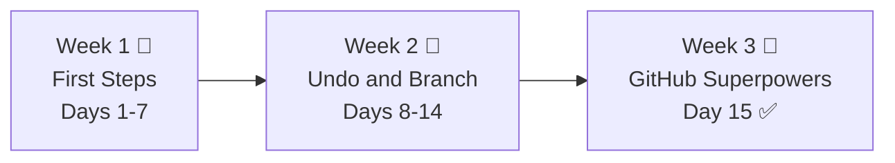
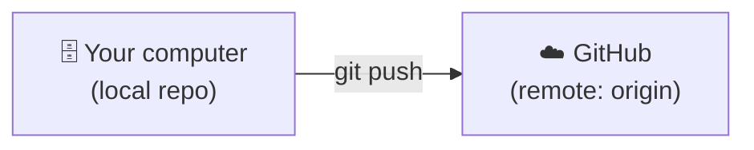

# 🎮 Git Quest: Days 1 to 15 at a Glance

**Created by Rutuja Naik**

Halfway there! Weeks 1 and 2 taught you to work on your own computer. **Week 3 is about GitHub.** Today you sent your work online for the first time with `git push`. This page recaps every day so far and explains Day 15 in detail.

## 🗺️ The journey so far



| Day | Topic | One-line takeaway |
|-----|-------|-------------------|
| 1 | Git vs GitHub | Git saves your work. GitHub shares it. |
| 2 | `git init` and your first commit | A commit is a save point. |
| 3 | The 3 areas of Git | Desk, packing table, cupboard. |
| 4 | `git add` and good commit messages | A message is the label on the box. |
| 5 | `git log` | `HEAD` means "you are here". |
| 6 | `git diff` | Red pen = removed, green pen = added. |
| 7 | Week 1 recap | Put it all together. |
| 8 | `.gitignore` | A "do not pack" list. |
| 9 | `git restore` and `git reset` | Pick the right undo. |
| 10 | `git commit --amend` | Reopen the last box. |
| 11 | What is a branch? | A sticky note on a commit. |
| 12 | `git switch` and `git branch` | Switching swaps your files. |
| 13 | `git merge` | Join two timelines. |
| 14 | Week 2 recap | The branching loop. |
| 15 | Remotes and `git push` | Send your commits to GitHub, the online warehouse. |

## 🚀 Day 15 in detail: remotes and `git push`

### The idea

So far your commits live only in the **cupboard on your own computer**. If your laptop breaks, they are gone, and nobody else can see them. A **remote** is a copy of your repository hosted somewhere else, usually on **GitHub**: the online warehouse from the Git-and-GitHub animation.

**`git push`** hands your commits to the courier, who delivers them to the warehouse.



### Key words

| Word | What it means |
|------|---------------|
| **Remote** | A copy of your repository hosted elsewhere (like GitHub) |
| **`origin`** | The default nickname for that remote's address |
| **`origin/main`** | Your computer's bookmark of where the remote's `main` was last time you talked to it |
| **Push** | Send your new commits to the remote |
| **`-u` (upstream)** | Links your local `main` to `origin/main`, so later you can just type `git push` |

> 📦 Push sends **commits**, not loose files. Uncommitted changes stay on your desk.

### Hands-on

**1. Make a local repo with two commits**

```bash
git init -b main push-lab && cd push-lab
echo "Pasta" > menu.txt && git add . && git commit -m "Add menu"
echo "Dessert" >> menu.txt && git add . && git commit -m "Add dessert"
```

**2. Create an EMPTY repository on GitHub**

`github.com` → **New repository** → name it `push-lab` → leave **"Add a README file" unticked** → **Create repository**. (An empty repo avoids clashes with your local history.)

**3. Connect and push**

```bash
git remote add origin https://github.com/YOUR-USERNAME/push-lab.git
git remote -v
# origin  https://github.com/YOUR-USERNAME/push-lab.git (fetch)
# origin  https://github.com/YOUR-USERNAME/push-lab.git (push)

git push -u origin main
# Writing objects: 100% (6/6), done.
# To https://github.com/YOUR-USERNAME/push-lab.git
#  * [new branch]      main -> main
# branch 'main' set up to track 'origin/main'.
```

Refresh the GitHub page: your files and both commits are there! 🎉

**4. Push again later**

```bash
echo "Salad" >> menu.txt && git add . && git commit -m "Add salad"
git status
# Your branch is ahead of 'origin/main' by 1 commit.
git push
#    3e7a1c9..5c0f8a2  main -> main
git status
# Your branch is up to date with 'origin/main'.
git branch -vv
# * main 5c0f8a2 [origin/main] Add salad
```

### 🔑 Logging in

GitHub no longer accepts your account password for pushes. Use one of:

- **HTTPS + Personal Access Token** (a long-lived password you create in GitHub settings)
- **SSH key** (a key pair, set up once)
- **Git Credential Manager** (comes with Git for Windows) or **GitHub CLI** (`gh auth login`), which make login easy

### 🆘 Common problems

| You see | What it means | Fix |
|---------|---------------|-----|
| `'origin' does not appear to be a git repository` | No remote added yet | `git remote add origin <url>` |
| `remote origin already exists` | You added it before | `git remote set-url origin <url>` to change it |
| `src refspec main does not match any` | No commit yet, or the branch has another name | Make a commit; check `git branch` |
| `rejected ... (fetch first)` | The remote has commits you do not have | Day 17 (`git pull`), or use an empty repo |
| `Authentication failed` | Wrong password | Use a token or SSH key |

## 🧰 Combined cheat sheet (Days 1 to 15)

| Command | What it does | Day |
|---------|--------------|-----|
| `git init -b main` | Creates a repository | 2 |
| `git status` | Which area is each file in? | 2, 3 |
| `git add <file>` / `git add .` | Desk → packing table | 2 to 4 |
| `git commit -m "message"` | Packing table → cupboard | 2 to 4 |
| `git log --oneline --graph` | Read history as a map | 5, 11 |
| `git diff` / `git diff --staged` | Compare changes | 6 |
| `git restore` / `git reset` / `git commit --amend` | Undo and fix | 9, 10 |
| `git switch -c <name>` / `git merge <branch>` | Branch and merge | 12, 13 |
| `git remote add origin <url>` | Link a remote called origin | 15 |
| `git remote -v` | List remotes | 15 |
| `git push -u origin main` | First push: link and send | 15 |
| `git push` | Later pushes | 15 |
| `git branch -vv` | Show which remote each branch tracks | 15 |

## 🧠 Day 15 mini quiz

1. What is `origin`?
2. What does `-u` do in `git push -u origin main`?
3. Does `git push` send uncommitted changes?

<details>
<summary>👀 Click to see the answers</summary>

1. The default nickname for the remote repository's address.
2. It links your local `main` to `origin/main`, so later you can just type `git push`.
3. No. Only commits are pushed.

</details>

## ✅ Skills unlocked so far

- [x] Everything from Weeks 1 and 2 (commits, undo, branches, merge)
- [x] Explain what a remote is
- [x] Connect a local repo to GitHub with `git remote add`
- [x] Push commits to GitHub
- [x] Read "ahead of" and "up to date" in `git status`

## 🔜 Coming up in Week 3: GitHub Superpowers 🚀

| Day | Topic |
|-----|-------|
| 16 | `git clone`: copy a repository |
| 17 | `git fetch` vs `git pull` |
| 18 | Merge conflicts |
| 19 | Forks |
| 20 | Pull requests |
| 21 | Week 3 recap: make a PR |

## 📌 Your Day 15 commit

| File | Message |
|------|---------|
| `days-1-to-15-summary.md` | `docs(day15): add days 1-15 summary and push notes` |

---

<p align="center"><i>Progress: 15 / 30 days complete. Halfway! 🐱</i></p>
