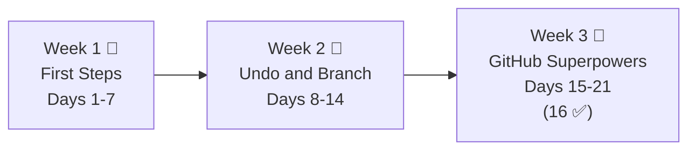
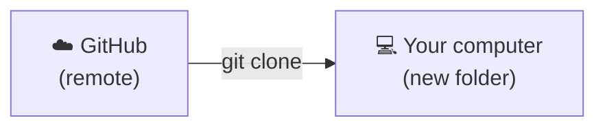

# 🎮 Git Quest: Days 1 to 16 at a Glance

**Created by Rutuja Naik**

Yesterday you sent a project **up** to GitHub. Today you learned the opposite move: bringing a project **down** to a computer with `git clone`. This page recaps every day so far and explains Day 16 in detail.

## 🗺️ The journey so far



| Day | Topic | One-line takeaway |
|-----|-------|-------------------|
| 1 | Git vs GitHub | Git saves your work. GitHub shares it. |
| 2 | `git init` and your first commit | A commit is a save point. |
| 3 | The 3 areas of Git | Desk, packing table, cupboard. |
| 4 | `git add` and good commit messages | A message is the label on the box. |
| 5 | `git log` | `HEAD` means "you are here". |
| 6 | `git diff` | Red pen = removed, green pen = added. |
| 7 | Week 1 recap | Put it all together. |
| 8 | `.gitignore` | A "do not pack" list. |
| 9 | `git restore` and `git reset` | Pick the right undo. |
| 10 | `git commit --amend` | Reopen the last box. |
| 11 | What is a branch? | A sticky note on a commit. |
| 12 | `git switch` and `git branch` | Switching swaps your files. |
| 13 | `git merge` | Join two timelines. |
| 14 | Week 2 recap | The branching loop. |
| 15 | Remotes and `git push` | Send commits up to GitHub. |
| 16 | `git clone` | Copy a whole repository from GitHub to your computer. |

## 📥 Day 16 in detail: `git clone`

### The idea

`git clone <url>` makes a **complete copy** of a repository from GitHub: every file, the **full history**, and the branches. It is like the Singapore friend from the courier animation collecting the entire warehouse shelf.



One command replaces three steps: it creates the folder, runs `git init`, **adds the remote called `origin`**, and links your local `main` to `origin/main`.

### Clone vs init vs download ZIP

| | `git init` | `git clone` | Download ZIP |
|---|-----------|-------------|--------------|
| **Starts from** | Nothing | An existing repo | An existing repo |
| **Files** | None | ✅ All | ✅ All |
| **History** | None | ✅ Full | ❌ None |
| **Remote `origin`** | ❌ No | ✅ Set automatically | ❌ No |
| **Use it when** | Starting fresh | Joining or copying a project | You only need the files once |

### Where to find the URL

On the repo's GitHub page, click the green **Code** button and copy the **HTTPS** URL (or the SSH one if you set up a key).

### Hands-on: be the Singapore computer

You will clone the `push-lab` repo from Day 15 into a **second folder**, as if it were another computer.

```bash
cd ..                                   # leave the push-lab folder
git clone https://github.com/YOUR-USERNAME/push-lab.git push-lab-copy
# Cloning into 'push-lab-copy'...
# Receiving objects: 100% (9/9), done.

cd push-lab-copy
cat menu.txt                            # Pasta, Dessert, Salad
git log --oneline
# 5c0f8a2 (HEAD -> main, origin/main, origin/HEAD) Add salad
# 3e7a1c9 Add dessert
# b84d2f0 Add menu

git remote -v                           # origin is already set!
git status
# Your branch is up to date with 'origin/main'.
git branch -a
# * main
#   remotes/origin/HEAD -> origin/main
#   remotes/origin/main
```

Now push a change **from the copy**. No `-u` is needed, because clone already linked the branch:

```bash
echo "Coffee" >> menu.txt && git add . && git commit -m "Add coffee"
git push
#    5c0f8a2..9e1d4b7  main -> main
```

Check GitHub: the new commit is there. 🎉 But your **original** `push-lab` folder does not know about it yet. Fixing that is **tomorrow's lesson** (`git fetch` and `git pull`).

### 🛟 Good to know

- The last part of the URL becomes the folder name. Add a name at the end to choose your own: `git clone <url> my-folder`.
- `git clone --depth 1 <url>` copies only the latest snapshot (faster for huge projects).
- Do not clone **inside** another repository folder. Nested repos get confusing.
- You can clone **your own git-quest repo** to work on this series from the terminal instead of the web editor.
- Cloning someone else's repo lets you read and run it. To contribute back you will use **forks** (Day 19).

### 🆘 Common problems

| You see | What it means | Fix |
|---------|---------------|-----|
| `destination path 'x' already exists and is not an empty directory` | A folder with that name exists | Pick another folder name |
| `Repository not found` | Typo in the URL, or the repo is private and you lack access | Check the URL and your login |
| `Authentication failed` | Wrong credentials | Use a token or SSH key (Day 15) |
| `You appear to have cloned an empty repository` | The remote has no commits yet | Make a commit and push |

## 🧰 Combined cheat sheet (Days 1 to 16)

| Command | What it does | Day |
|---------|--------------|-----|
| `git init -b main` | Creates a new repository | 2 |
| `git status` / `git log --oneline --graph` | See where you are | 2 to 5 |
| `git add` / `git commit -m` | Pack and save | 2 to 4 |
| `git restore` / `git reset` / `git commit --amend` | Undo and fix | 9, 10 |
| `git switch -c <name>` / `git merge <branch>` | Branch and merge | 12, 13 |
| `git remote add origin <url>` | Link a remote | 15 |
| `git push -u origin main` / `git push` | Send commits to GitHub | 15 |
| `git clone <url>` | Copy a repository from GitHub | 16 |
| `git clone <url> <folder>` | Clone into a folder you name | 16 |
| `git branch -a` | List local and remote branches | 16 |

## 🧠 Day 16 mini quiz

1. Name two things `git clone` sets up that you would otherwise do by hand.
2. Is a downloaded ZIP the same as a clone?
3. After cloning, do you need to run `git remote add origin`?

<details>
<summary>👀 Click to see the answers</summary>

1. Creating the repository, adding the `origin` remote, and linking `main` to `origin/main` (any two).
2. No. A ZIP has the files but no history and no remote.
3. No. `origin` is added automatically.

</details>

## ✅ Skills unlocked so far

- [x] Everything from Weeks 1 and 2 (commits, undo, branches, merge)
- [x] Push commits to GitHub
- [x] Clone a repository and explore what arrived
- [x] Push a change from a cloned copy

## 🔜 Coming up in Week 3: GitHub Superpowers 🚀

| Day | Topic |
|-----|-------|
| 17 | `git fetch` vs `git pull`: stay up to date |
| 18 | Merge conflicts |
| 19 | Forks |
| 20 | Pull requests |
| 21 | Week 3 recap: make a PR |

## 📌 Your Day 16 commit

| File | Message |
|------|---------|
| `days-1-to-16-summary.md` | `docs(day16): add days 1-16 summary and clone notes` |

---

<p align="center"><i>Progress: 16 / 30 days complete. Cloning around! 🐱</i></p>
