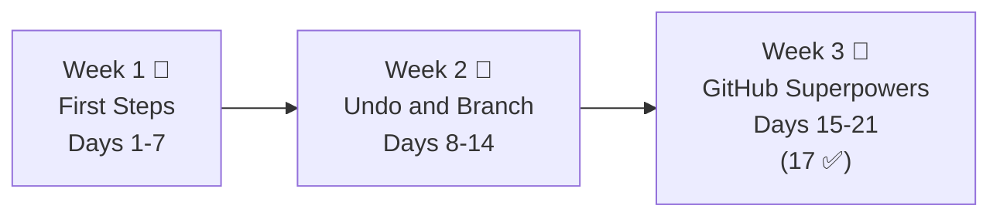
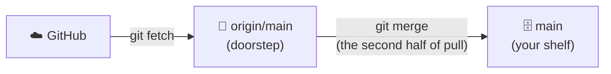

# 🎮 Git Quest: Days 1 to 17 at a Glance

**Created by Rutuja Naik**

Yesterday you cloned a repo and ended with a puzzle: your original folder did not know about a new commit on GitHub. Today you solved it with **`git fetch`** and **`git pull`**. This page recaps every day so far and explains Day 17 in detail.

## 🗺️ The journey so far



| Day | Topic | One-line takeaway |
|-----|-------|-------------------|
| 1 | Git vs GitHub | Git saves your work. GitHub shares it. |
| 2 | `git init` and your first commit | A commit is a save point. |
| 3 | The 3 areas of Git | Desk, packing table, cupboard. |
| 4 | `git add` and good commit messages | A message is the label on the box. |
| 5 | `git log` | `HEAD` means "you are here". |
| 6 | `git diff` | Red pen = removed, green pen = added. |
| 7 | Week 1 recap | Put it all together. |
| 8 | `.gitignore` | A "do not pack" list. |
| 9 | `git restore` and `git reset` | Pick the right undo. |
| 10 | `git commit --amend` | Reopen the last box. |
| 11 | What is a branch? | A sticky note on a commit. |
| 12 | `git switch` and `git branch` | Switching swaps your files. |
| 13 | `git merge` | Join two timelines. |
| 14 | Week 2 recap | The branching loop. |
| 15 | Remotes and `git push` | Send commits up to GitHub. |
| 16 | `git clone` | Copy a whole repo from GitHub. |
| 17 | `git fetch` vs `git pull` | Fetch = look. Pull = look and update. |

## 🔄 Day 17 in detail: `git fetch` vs `git pull`

### The idea

GitHub can get **new commits** that your computer has not seen (a teammate pushed, or you pushed from another computer). Your local repo does not find out by itself. You have to ask.

| Command | What it does | Analogy |
|---------|--------------|---------|
| **`git fetch`** | Downloads the new commits and updates your `origin/main` bookmark. **Your branch and files do not change.** | The courier leaves the boxes **on your doorstep**. You have not unpacked them. |
| **`git pull`** | `git fetch` **plus** `git merge`. Your branch and files **do** change. | You bring the boxes in and **unpack them onto your shelf**. |

> **`git pull` = `git fetch` + `git merge origin/main`**



### Three states, one story

| Step | GitHub | `origin/main` (your bookmark) | `main` (your branch) |
|------|--------|-------------------------------|----------------------|
| Before | has commit 4 | stale: at commit 3 | at commit 3 |
| After `git fetch` | has commit 4 | **moves to commit 4** | still at commit 3 ("behind") |
| After `git pull` | has commit 4 | at commit 4 | **moves to commit 4** |

### Read `git status` like a signpost

| `git status` says | Meaning | What to do |
|-------------------|---------|------------|
| `up to date with 'origin/main'` | In sync (as of your last fetch) | Nothing |
| `behind 'origin/main' by 1 commit` | GitHub has newer commits | `git pull` |
| `ahead of 'origin/main' by 1 commit` | You have commits GitHub lacks | `git push` |
| `have diverged` | Both sides have new commits | `git pull`, then `git push` |

### Hands-on: finish Day 16's story

In your **original** `push-lab` folder (the one that does not know about the Coffee commit):

```bash
cd ../push-lab
git status
# Your branch is up to date with 'origin/main'.   <- stale! It has not looked.

git fetch
#    5c0f8a2..9e1d4b7  main       -> origin/main

git status
# Your branch is behind 'origin/main' by 1 commit, and can be fast-forwarded.

git log --oneline main..origin/main        # what's new on GitHub?
# 9e1d4b7 Add coffee
cat menu.txt                               # Pasta, Dessert, Salad (no coffee yet!)

git pull
# Updating 5c0f8a2..9e1d4b7
# Fast-forward
#  menu.txt | 1 +
cat menu.txt                               # ...and now Coffee is there ☕
```

### Bonus: when both sides moved

Add a different file on each side so nothing clashes.

```bash
# In push-lab-copy:
echo "Tea" > tea.txt && git add . && git commit -m "Add tea" && git push

# In push-lab (original):
echo "Juice" > juice.txt && git add . && git commit -m "Add juice"
git push
# ! [rejected]  main -> main (fetch first)
# hint: Updates were rejected because the remote contains work that you do not have locally.

git pull --no-edit
# Merge made by the 'ort' strategy.
#  tea.txt | 1 +
git push                                   # works now ✅
```

That "rejected (fetch first)" error from Day 15 now makes sense: GitHub had commits you had not fetched. The fix is always **pull, then push**.

### 🛟 Good to know

- **Fetch is always safe.** It never changes your files, so you can fetch as often as you like.
- **Pull can change your files.** If both sides edited the same lines you will get a *merge conflict*. That is **tomorrow's lesson** (Day 18).
- A pull that needs a merge commit may open an editor. Add `--no-edit` to skip it (Vim: `Esc`, `:wq`, `Enter`).
- Many developers `git fetch` first, look at `git log main..origin/main`, then decide whether to pull.

## 🧰 Combined cheat sheet (Days 1 to 17)

| Command | What it does | Day |
|---------|--------------|-----|
| `git init -b main` | Creates a new repository | 2 |
| `git status` / `git log --oneline --graph` | See where you are | 2 to 5 |
| `git add` / `git commit -m` | Pack and save | 2 to 4 |
| `git restore` / `git reset` / `git commit --amend` | Undo and fix | 9, 10 |
| `git switch -c <name>` / `git merge <branch>` | Branch and merge | 12, 13 |
| `git remote add origin <url>` / `git push -u origin main` | Link and send to GitHub | 15 |
| `git clone <url>` | Copy a repo from GitHub | 16 |
| `git fetch` | Download news, change nothing | 17 |
| `git pull` | Fetch + merge into your branch | 17 |
| `git pull --no-edit` | Pull without the editor popping up | 17 |
| `git log main..origin/main` | What is new on GitHub? | 17 |

## 🧠 Day 17 mini quiz

1. Does `git fetch` change the files in your folder?
2. What is `git pull` made of?
3. Your push is rejected with "fetch first". What do you do?

<details>
<summary>👀 Click to see the answers</summary>

1. No. It only updates `origin/main`.
2. `git fetch` followed by `git merge`.
3. `git pull`, then `git push` again.

</details>

## ✅ Skills unlocked so far

- [x] Everything from Weeks 1 and 2 (commits, undo, branches, merge)
- [x] Push to and clone from GitHub
- [x] Tell fetch from pull, and use each on purpose
- [x] Read "behind", "ahead" and "diverged" in `git status`
- [x] Fix a "rejected (fetch first)" push

## 🔜 Coming up in Week 3: GitHub Superpowers 🚀

| Day | Topic |
|-----|-------|
| 18 | Merge conflicts |
| 19 | Forks |
| 20 | Pull requests |
| 21 | Week 3 recap: make a PR |

## 📌 Your Day 17 commit

| File | Message |
|------|---------|
| `days-1-to-17-summary.md` | `docs(day17): add days 1-17 summary and fetch-pull notes` |

---

<p align="center"><i>Progress: 17 / 30 days complete. In sync! 🐱</i></p>
