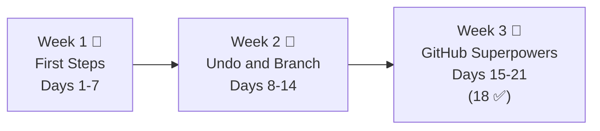
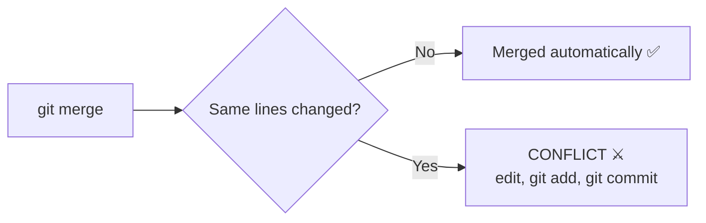

# 🎮 Git Quest: Days 1 to 18 at a Glance

**Created by Rutuja Naik**

Yesterday you learned that a pull can bring other people's work in. Today you learned what happens when that work **clashes** with yours: a **merge conflict**. Spoiler: it is normal, it is fixable, and it looks scarier than it is. This page recaps every day so far and explains Day 18 in detail.

## 🗺️ The journey so far



| Day | Topic | One-line takeaway |
|-----|-------|-------------------|
| 1 | Git vs GitHub | Git saves your work. GitHub shares it. |
| 2 | `git init` and your first commit | A commit is a save point. |
| 3 | The 3 areas of Git | Desk, packing table, cupboard. |
| 4 | `git add` and good commit messages | A message is the label on the box. |
| 5 | `git log` | `HEAD` means "you are here". |
| 6 | `git diff` | Red pen = removed, green pen = added. |
| 7 | Week 1 recap | Put it all together. |
| 8 | `.gitignore` | A "do not pack" list. |
| 9 | `git restore` and `git reset` | Pick the right undo. |
| 10 | `git commit --amend` | Reopen the last box. |
| 11 | What is a branch? | A sticky note on a commit. |
| 12 | `git switch` and `git branch` | Switching swaps your files. |
| 13 | `git merge` | Join two timelines. |
| 14 | Week 2 recap | The branching loop. |
| 15 | Remotes and `git push` | Send commits up to GitHub. |
| 16 | `git clone` | Copy a whole repo from GitHub. |
| 17 | `git fetch` vs `git pull` | Fetch = look. Pull = look and update. |
| 18 | Merge conflicts | When two edits clash, you pick the winner. |

## ⚔️ Day 18 in detail: merge conflicts

### The idea

Two cooks edit the **same line** of the same recipe, one writing "Spicy pasta" and the other "Pizza". When you merge, Git cannot guess which one you want. So it **stops, marks the file, and asks you**. That is a **merge conflict**.

It is not an error and nothing is broken. Git is simply handing the decision to a human.



> Conflicts only happen when **both sides changed the same lines**. Different files, or different parts of the same file, merge without any fuss.

### Reading the markers

Git writes both versions into the file between three marker lines:

```text
<<<<<<< HEAD
Today's special: Pizza
=======
Today's special: Spicy pasta
>>>>>>> spicy
```

| Marker | Meaning |
|--------|---------|
| `<<<<<<< HEAD` | **Start.** Below it is **your** version (the branch you are on). |
| `=======` | **Divider** between the two versions. |
| `>>>>>>> spicy` | **End.** Above it is the **incoming** version (from the branch you are merging in). |

### The 4-step fix

1. **See it:** `git status` lists the file under *Unmerged paths* ("both modified").
2. **Edit it:** open the file. Keep yours, keep theirs, or combine both. **Delete the three marker lines.**
3. **Mark it resolved:** `git add <file>`.
4. **Finish the merge:** `git commit`.

**Escape hatch:** `git merge --abort` cancels the merge and takes you back to how things were before.

### Hands-on: make a conflict on purpose

```bash
git init -b main conflict-lab && cd conflict-lab
echo "Today's special: Pasta" > special.txt
git add . && git commit -m "Add special"

git switch -c spicy
echo "Today's special: Spicy pasta" > special.txt
git add . && git commit -m "Make it spicy"

git switch main
echo "Today's special: Pizza" > special.txt
git add . && git commit -m "Switch to pizza"

git merge spicy
# Auto-merging special.txt
# CONFLICT (content): Merge conflict in special.txt
# Automatic merge failed; fix conflicts and then commit the result.

git status
# You have unmerged paths.
#   both modified:   special.txt

cat special.txt                      # shows the markers

echo "Today's special: Spicy pizza" > special.txt    # combine both ideas, no markers
git add special.txt
git commit -m "Merge spicy: spicy pizza"

git log --oneline --graph
# *   7e2b9a1 (HEAD -> main) Merge spicy: spicy pizza
# |\
# | * c41d8e3 (spicy) Make it spicy
# * | 9b03f5a Switch to pizza
# |/
# * 2f6a8d1 Add special
```

In real projects you will usually fix the file in an editor. In **VS Code**, buttons above each conflict say **Accept Current**, **Accept Incoming** or **Accept Both**.

### 🛟 Good to know

- **Conflicts can happen on `git pull` too**, because a pull contains a merge. The fix is the same four steps, and `git merge --abort` still works.
- A file can contain **several conflict blocks**. Fix them all before `git add`.
- **Never commit with markers left in.** Search the file for `<<<<<<<` before you `git add`.
- **Avoid conflicts:** pull often, commit small and often, split work into different files, and talk to your teammates.

## 🧰 Combined cheat sheet (Days 1 to 18)

| Command | What it does | Day |
|---------|--------------|-----|
| `git init -b main` | Creates a new repository | 2 |
| `git status` / `git log --oneline --graph` | See where you are | 2 to 5 |
| `git add` / `git commit -m` | Pack and save | 2 to 4 |
| `git restore` / `git reset` / `git commit --amend` | Undo and fix | 9, 10 |
| `git switch -c <name>` / `git merge <branch>` | Branch and merge | 12, 13 |
| `git push -u origin main` / `git clone <url>` | Send to and copy from GitHub | 15, 16 |
| `git fetch` / `git pull` | Look at / bring in new commits | 17 |
| `git status` (Unmerged paths) | Spot a conflict | 18 |
| `git add <file>` then `git commit` | Resolve a conflict and finish the merge | 18 |
| `git merge --abort` | Cancel a merge and go back | 13, 18 |

## 🧠 Day 18 mini quiz

1. What causes a merge conflict?
2. What do `<<<<<<<`, `=======` and `>>>>>>>` mark?
3. After you edit the file to fix a conflict, which two commands finish the merge?

<details>
<summary>👀 Click to see the answers</summary>

1. Both sides changed the same lines of the same file in different ways.
2. The start of your version, the divider, and the end of the incoming version.
3. `git add <file>` and then `git commit`.

</details>

## ✅ Skills unlocked so far

- [x] Everything from Weeks 1 and 2 (commits, undo, branches, merge)
- [x] Push, clone, fetch and pull
- [x] Recognise a merge conflict and read its markers
- [x] Resolve a conflict in four steps
- [x] Abort a merge when you want a fresh start

## 🔜 Coming up in Week 3: GitHub Superpowers 🚀

| Day | Topic |
|-----|-------|
| 19 | Forks: copy someone else's repo to your account |
| 20 | Pull requests |
| 21 | Week 3 recap: make a PR |

## 📌 Your Day 18 commit

| File | Message |
|------|---------|
| `days-1-to-18-summary.md` | `docs(day18): add days 1-18 summary and conflict notes` |

---

<p align="center"><i>Progress: 18 / 30 days complete. Conflict-proof! 🐱</i></p>
