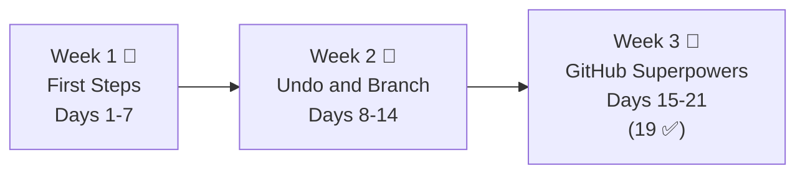
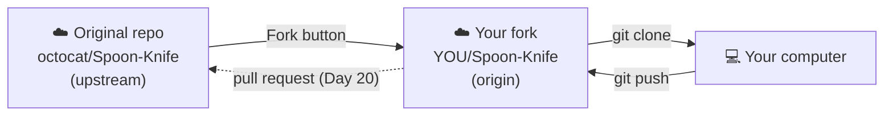

# 🎮 Git Quest: Days 1 to 19 at a Glance

**Created by Rutuja Naik**

So far you have worked on **your own** repositories. Today you learned how to work on **someone else's**: you make your own copy on GitHub, called a **fork**. This page recaps every day so far and explains Day 19 in detail.

## 🗺️ The journey so far



| Day | Topic | One-line takeaway |
|-----|-------|-------------------|
| 1 | Git vs GitHub | Git saves your work. GitHub shares it. |
| 2 | `git init` and your first commit | A commit is a save point. |
| 3 | The 3 areas of Git | Desk, packing table, cupboard. |
| 4 | `git add` and good commit messages | A message is the label on the box. |
| 5 | `git log` | `HEAD` means "you are here". |
| 6 | `git diff` | Red pen = removed, green pen = added. |
| 7 | Week 1 recap | Put it all together. |
| 8 | `.gitignore` | A "do not pack" list. |
| 9 | `git restore` and `git reset` | Pick the right undo. |
| 10 | `git commit --amend` | Reopen the last box. |
| 11 | What is a branch? | A sticky note on a commit. |
| 12 | `git switch` and `git branch` | Switching swaps your files. |
| 13 | `git merge` | Join two timelines. |
| 14 | Week 2 recap | The branching loop. |
| 15 | Remotes and `git push` | Send commits up to GitHub. |
| 16 | `git clone` | Copy a whole repo from GitHub. |
| 17 | `git fetch` vs `git pull` | Fetch = look. Pull = look and update. |
| 18 | Merge conflicts | When two edits clash, you pick the winner. |
| 19 | Forks | Your own copy of someone else's repo, on GitHub. |

## 🍴 Day 19 in detail: forks

### The idea

You find a great project on GitHub, but it is **not yours**, so you cannot push to it. A **fork** is **your own copy of that repository, stored in your GitHub account**. You own the fork, so you can push to it freely, and later you can ask the original owner to accept your changes (that is a *pull request*, tomorrow's lesson).



### Fork vs clone vs branch

| | Where the copy lives | What it is |
|---|----------------------|------------|
| **Fork** | On GitHub, in **your account** | A whole separate copy of someone's repo |
| **Clone** | On **your computer** | A copy of a repo downloaded from GitHub |
| **Branch** | Inside **one** repo | A parallel line of work |

### Two names to remember

| Remote name | Points to |
|-------------|-----------|
| **`origin`** | **Your fork** (set automatically when you clone it) |
| **`upstream`** | **The original repo** (you add it yourself) |

### The fork workflow

1. **Fork** the repo on GitHub (the **Fork** button, top right).
2. **Clone your fork** to your computer.
3. Create a **branch** for your change.
4. **Commit** your work.
5. **Push** the branch to `origin` (your fork).
6. Open a **pull request** to the original (Day 20).

### Hands-on: fork a practice repo

GitHub's official practice repo is `octocat/Spoon-Knife` (any public repo works too).

```bash
# 1. On GitHub: open github.com/octocat/Spoon-Knife and click Fork > Create fork

# 2. Clone YOUR fork
git clone https://github.com/YOUR-USERNAME/Spoon-Knife.git
cd Spoon-Knife
git remote -v
# origin  https://github.com/YOUR-USERNAME/Spoon-Knife.git (fetch)
# origin  https://github.com/YOUR-USERNAME/Spoon-Knife.git (push)

# 3. Remember the original as upstream
git remote add upstream https://github.com/octocat/Spoon-Knife.git
git remote -v
# origin    https://github.com/YOUR-USERNAME/Spoon-Knife.git (fetch/push)
# upstream  https://github.com/octocat/Spoon-Knife.git (fetch/push)

# 4. Work on a branch, not on main
git switch -c add-my-name
echo "Hello from me" > hello-from-me.txt
git add . && git commit -m "Add greeting from me"
git push -u origin add-my-name
# remote: Create a pull request for 'add-my-name' on GitHub by visiting:
# remote:   https://github.com/YOUR-USERNAME/Spoon-Knife/pull/new/add-my-name
```

That last message is GitHub inviting you to open a pull request. You will do that tomorrow.

### Keep your fork up to date

The original keeps changing. To catch up:

```bash
git fetch upstream                 # look at the original's new commits
git switch main
git merge upstream/main            # bring them into your main
git push origin main               # update your fork on GitHub
```

(If the original's default branch is `master`, use `upstream/master`.) On GitHub's website, a **Sync fork** button does the same job in one click.

### 🛟 Good to know

- **Branch for every change.** Keep your fork's `main` as a clean mirror of the original.
- **A fork shows its parent.** GitHub prints *"forked from octocat/Spoon-Knife"* under the repo name.
- **Read the rules.** Many projects have a `CONTRIBUTING.md` file explaining how they like changes sent.
- **Be kind and keep changes small.** Maintainers are often volunteers.

## 🧰 Combined cheat sheet (Days 1 to 19)

| Command | What it does | Day |
|---------|--------------|-----|
| `git init -b main` | Creates a new repository | 2 |
| `git status` / `git log --oneline --graph` | See where you are | 2 to 5 |
| `git add` / `git commit -m` | Pack and save | 2 to 4 |
| `git switch -c <name>` / `git merge <branch>` | Branch and merge | 12, 13 |
| `git push -u origin main` / `git clone <url>` | Send to and copy from GitHub | 15, 16 |
| `git fetch` / `git pull` | Look at / bring in new commits | 17 |
| `git add` then `git commit` (conflict) | Resolve a merge conflict | 18 |
| `git remote add upstream <url>` | Remember the original repo | 19 |
| `git fetch upstream` / `git merge upstream/main` | Sync your fork with the original | 19 |
| `git push origin <branch>` | Send your branch to your fork | 19 |

## 🧠 Day 19 mini quiz

1. What is a fork?
2. What is the difference between a fork and a clone?
3. In a fork workflow, what are `origin` and `upstream`?

<details>
<summary>👀 Click to see the answers</summary>

1. Your own copy of someone else's repository, stored in your GitHub account.
2. A fork is a copy on GitHub (in your account). A clone is a copy on your computer.
3. `origin` is your fork. `upstream` is the original repository.

</details>

## ✅ Skills unlocked so far

- [x] Everything from Weeks 1 and 2 (commits, undo, branches, merge)
- [x] Push, clone, fetch and pull
- [x] Resolve a merge conflict
- [x] Fork a repository and clone your fork
- [x] Add an `upstream` remote and keep a fork in sync

## 🔜 Coming up in Week 3: GitHub Superpowers 🚀

| Day | Topic |
|-----|-------|
| 20 | Pull requests |
| 21 | Week 3 recap: make a PR |

## 📌 Your Day 19 commit

| File | Message |
|------|---------|
| `days-1-to-19-summary.md` | `docs(day19): add days 1-19 summary and fork notes` |

---

<p align="center"><i>Progress: 19 / 30 days complete. Forking ahead! 🐱</i></p>
