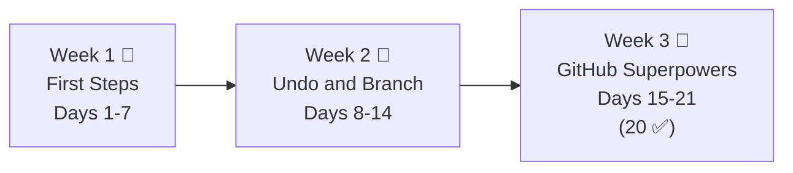
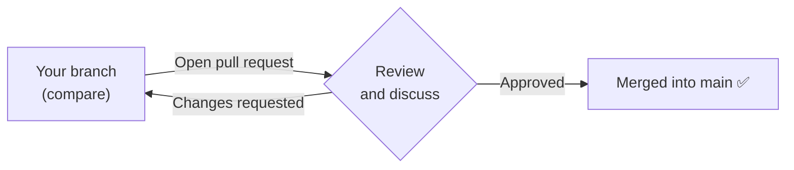

# 🎮 Git Quest: Days 1 to 20 at a Glance

**Created by Rutuja Naik**

Two-thirds of the way there! Yesterday you made your own copy of a project with a fork. Today you learned how to **ask the owner to accept your changes**: the **pull request**, the heart of teamwork on GitHub. This page recaps every day so far and explains Day 20 in detail.

## 🗺️ The journey so far



| Day | Topic | One-line takeaway |
|-----|-------|-------------------|
| 1 | Git vs GitHub | Git saves your work. GitHub shares it. |
| 2 | `git init` and your first commit | A commit is a save point. |
| 3 | The 3 areas of Git | Desk, packing table, cupboard. |
| 4 | `git add` and good commit messages | A message is the label on the box. |
| 5 | `git log` | `HEAD` means "you are here". |
| 6 | `git diff` | Red pen = removed, green pen = added. |
| 7 | Week 1 recap | Put it all together. |
| 8 | `.gitignore` | A "do not pack" list. |
| 9 | `git restore` and `git reset` | Pick the right undo. |
| 10 | `git commit --amend` | Reopen the last box. |
| 11 | What is a branch? | A sticky note on a commit. |
| 12 | `git switch` and `git branch` | Switching swaps your files. |
| 13 | `git merge` | Join two timelines. |
| 14 | Week 2 recap | The branching loop. |
| 15 | Remotes and `git push` | Send commits up to GitHub. |
| 16 | `git clone` | Copy a whole repo from GitHub. |
| 17 | `git fetch` vs `git pull` | Fetch = look. Pull = look and update. |
| 18 | Merge conflicts | When two edits clash, you pick the winner. |
| 19 | Forks | Your own copy of someone else's repo. |
| 20 | Pull requests | Ask for your branch to be merged, and talk it through. |

## 🙋 Day 20 in detail: pull requests

### The idea

A **pull request** (PR) is a page on GitHub where you say: *"I made some changes on this branch. Please **pull** them into that branch."* It shows exactly what changed, lets people **discuss and review**, and ends with a **Merge** button.

It is not a Git command. It is a **GitHub feature** built on top of branches, and it is how almost every team and open-source project accepts changes.



### Two names on every PR

| Word | Meaning |
|------|---------|
| **base** | The branch your changes should go **into** (usually `main`) |
| **compare** (or **head**) | The branch that **contains** your changes |

In a fork workflow, the base is in the **original** repo and the compare branch is in **your fork**. Inside your own repo, both are in the same place.

### The life of a PR

| Stage | What happens |
|-------|--------------|
| 🟢 **Open** | You created it. People can read, comment and review. |
| 💬 **Review** | Reviewers comment on lines of code. You push **more commits to the same branch** and the PR updates by itself. |
| 🟣 **Merged** | Someone clicked **Merge pull request**. Your commits are now in the base branch. |
| 🔴 **Closed** | Closed without merging (rejected, or you changed your mind). |

### Hands-on: a PR in your own repo

Practice in a repo **you own**, so you can merge it yourself. (`octocat/Spoon-Knife` will not accept practice PRs.) This works in `push-lab` or your `git-quest` repo.

```bash
cd push-lab
git switch -c add-tea-menu
echo "Tea" > tea.txt && git add . && git commit -m "Add tea menu"
git push -u origin add-tea-menu
# remote: Create a pull request for 'add-tea-menu' on GitHub by visiting:
# remote:   https://github.com/YOUR-USERNAME/push-lab/pull/new/add-tea-menu
```

Then in the browser:

1. Open your repo on GitHub. Click the yellow **Compare & pull request** banner.
2. Check the top line: **base: `main` ← compare: `add-tea-menu`**.
3. Write a clear **title** and a short **description**. Click **Create pull request**.
4. Read the **Files changed** tab, then click **Merge pull request** → **Confirm merge**.
5. Click **Delete branch** to tidy up.

Back in the terminal:

```bash
git switch main
git pull
# Updating 9e1d4b7..c5a82e6
# Fast-forward
#  tea.txt | 1 +
git branch -d add-tea-menu          # delete the local branch
git fetch --prune                   # forget the deleted remote branch
```

### ✍️ A good pull request

| Part | Tip |
|------|-----|
| **Title** | Short and clear, like a commit message: `Add tea menu` |
| **Description** | What changed and **why**. Add screenshots if it looks different. |
| **Size** | Small and focused. One idea per PR. |
| **Links** | Mention issues, for example `Closes #12` (issues arrive on Day 27) |
| **Feedback** | Reply kindly. Push fixes to the same branch. Do not open a new PR. |

### Three ways GitHub can merge

| Option | Result |
|--------|--------|
| **Create a merge commit** | Keeps every commit and adds a merge commit (the diamond from Day 13) |
| **Squash and merge** | Squashes all the PR's commits into **one** commit on `main` |
| **Rebase and merge** | Replays the commits on top of `main` (rebase arrives on Day 23) |

### 🛟 Good to know

- **After a fork PR is merged,** sync your fork: `git fetch upstream`, `git merge upstream/main`, `git push origin main`.
- **A draft PR** says "work in progress, not ready yet".
- **Conflicts:** if GitHub says the PR has conflicts, merge `main` into your branch locally, fix them (Day 18), and push.
- **Open-source etiquette:** read `CONTRIBUTING.md` first and keep changes small.

## 🧰 Combined cheat sheet (Days 1 to 20)

| Command / action | What it does | Day |
|------------------|--------------|-----|
| `git init -b main` / `git add` / `git commit -m` | Create, pack and save | 2 to 4 |
| `git switch -c <name>` / `git merge <branch>` | Branch and merge | 12, 13 |
| `git push -u origin <branch>` | Publish a branch to GitHub | 15 |
| `git clone <url>` / `git fetch` / `git pull` | Copy and update from GitHub | 16, 17 |
| Resolve a conflict | Edit, `git add`, `git commit` | 18 |
| Fork + `git remote add upstream <url>` | Your copy of someone's repo | 19 |
| **Compare & pull request** (GitHub) | Open a PR | 20 |
| **Merge pull request** (GitHub) | Accept the PR | 20 |
| `git switch main && git pull` | Bring the merged work home | 20 |
| `git branch -d <name>` / `git fetch --prune` | Tidy up local branches | 20 |

## 🧠 Day 20 mini quiz

1. What is a pull request?
2. In a PR, what are the **base** and **compare** branches?
3. A reviewer asks for changes. Do you open a new PR?

<details>
<summary>👀 Click to see the answers</summary>

1. A GitHub page asking for your branch's changes to be merged into another branch, with space to review and discuss them.
2. **Base** is the branch the changes go into. **Compare** is the branch that contains your changes.
3. No. Push more commits to the same branch and the PR updates automatically.

</details>

## ✅ Skills unlocked so far

- [x] Everything from Weeks 1 and 2 (commits, undo, branches, merge)
- [x] Push, clone, fetch, pull and resolve conflicts
- [x] Fork a repo and sync it with the original
- [x] Open, read and merge a pull request
- [x] Write a PR title and description people can follow

## 🔜 Coming up in Week 3: GitHub Superpowers 🚀

| Day | Topic |
|-----|-------|
| 21 | Week 3 recap: make a PR (quiz, cheat sheet and a final quest) |

## 📌 Your Day 20 commit

| File | Message |
|------|---------|
| `days-1-to-20-summary.md` | `docs(day20): add days 1-20 summary and pull request notes` |

---

<p align="center"><i>Progress: 20 / 30 days complete. Two-thirds done! 🐱</i></p>
