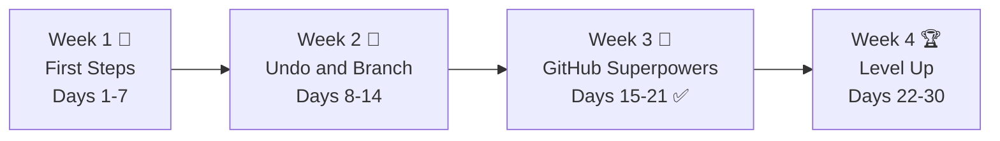
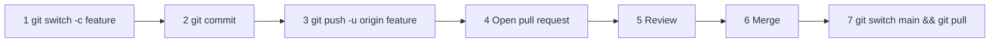

# 🏆 Git Quest: Week 3 Recap (Days 1 to 21)

**Created by Rutuja Naik**

Week 3 is complete! In three weeks you went from "What is Git?" to collaborating on GitHub: pushing, cloning, fetching, pulling, fixing conflicts, forking and opening pull requests. This page recaps everything, with a cheat sheet, a quiz and a final quest.

## 🗺️ Your journey so far



| Day | Topic | One-line takeaway |
|-----|-------|-------------------|
| 1 | Git vs GitHub | Git saves your work. GitHub shares it. |
| 2 | `git init` and your first commit | A commit is a save point. |
| 3 | The 3 areas of Git | Desk, packing table, cupboard. |
| 4 | `git add` and good commit messages | A message is the label on the box. |
| 5 | `git log` | `HEAD` means "you are here". |
| 6 | `git diff` | Red pen = removed, green pen = added. |
| 7 | Week 1 recap | Put it all together. |
| 8 | `.gitignore` | A "do not pack" list. |
| 9 | `git restore` and `git reset` | Pick the right undo. |
| 10 | `git commit --amend` | Reopen the last box. |
| 11 | What is a branch? | A sticky note on a commit. |
| 12 | `git switch` and `git branch` | Switching swaps your files. |
| 13 | `git merge` | Join two timelines. |
| 14 | Week 2 recap | The branching loop. |
| 15 | Remotes and `git push` | Send commits up to GitHub. |
| 16 | `git clone` | Copy a whole repo from GitHub. |
| 17 | `git fetch` vs `git pull` | Fetch = look. Pull = look and update. |
| 18 | Merge conflicts | When two edits clash, you pick the winner. |
| 19 | Forks | Your own copy of someone else's repo. |
| 20 | Pull requests | Ask for your branch to be merged, and talk it through. |
| 21 | Week 3 recap | The whole GitHub flow, end to end 🏆 |

## 📖 Week 3 in one page

### Day 15: remotes and `git push`
A **remote** is a copy of your repo hosted elsewhere, usually GitHub. `origin` is the default nickname. `git push -u origin main` sends your commits and links `main` to `origin/main`. GitHub does not accept your account password, so use a token, an SSH key or `gh auth login`.

### Day 16: `git clone`
Copies a whole repo: files, full history and branches. It also sets up `origin` and branch tracking automatically. A ZIP download has none of that.

### Day 17: `git fetch` vs `git pull`
`git fetch` downloads new commits to `origin/main` and **changes nothing else**. `git pull` is **fetch + merge** and updates your branch and files. Read `git status` as a signpost: up to date, behind, ahead or diverged. A push rejected with "fetch first" means: pull, then push.

### Day 18: merge conflicts
When both sides change the **same lines**, Git marks the file with `<<<<<<<`, `=======` and `>>>>>>>`. Fix it in four steps: see it (`git status`), edit it (delete the markers), `git add`, `git commit`. Escape with `git merge --abort`.

### Day 19: forks
A fork is your own copy of someone else's repo on GitHub. After cloning your fork, `origin` is your fork and `upstream` is the original. Keep in sync with `git fetch upstream`, `git merge upstream/main`, `git push origin main`.

### Day 20: pull requests
A PR asks for your **compare** branch to be merged into the **base** branch, with room for review and discussion. Push more commits to the same branch to update it. After merging, `git switch main && git pull` and delete the branch.

## 🧠 The GitHub flow in one picture



| Where | Steps |
|-------|-------|
| 💻 **On your computer** | 1 branch, 2 commit, 3 push, 7 pull |
| ☁️ **On GitHub** | 4 open the PR, 5 review, 6 merge |

### When things go wrong

| You see | Do this |
|---------|---------|
| Push rejected (`fetch first`) | `git pull`, then `git push` |
| `CONFLICT` | Edit the file, `git add`, `git commit` (or `git merge --abort`) |
| Wrong remote address | `git remote set-url origin <url>` |
| PR says it has conflicts | Merge `main` into your branch locally, fix, push |

## 🧰 Week 3 cheat sheet

| Group | Command | What it does |
|-------|---------|--------------|
| **Remotes** | `git remote add origin <url>` | Link a remote called origin |
| | `git remote -v` | List remotes |
| | `git push -u origin main` | First push: link and send |
| | `git push` | Later pushes |
| **Copy and update** | `git clone <url>` | Copy a repo from GitHub |
| | `git fetch` | Download news, change nothing |
| | `git pull` | Fetch + merge |
| | `git log main..origin/main` | What is new on GitHub? |
| **Conflicts** | `git status` | Shows *Unmerged paths* |
| | edit, `git add`, `git commit` | Resolve and finish the merge |
| | `git merge --abort` | Cancel the merge |
| **Forks and PRs** | `git remote add upstream <url>` | Remember the original |
| | `git fetch upstream` then `git merge upstream/main` | Sync your fork |
| | **Compare & pull request** / **Merge pull request** | Open / accept a PR (GitHub) |
| | `git switch main && git pull` | Bring merged work home |
| | `git branch -d <branch>` | Delete the local branch |

## 📝 Boss quiz (10 questions)

1. What is a remote, and what is `origin`?
2. What does `git push -u origin main` do?
3. Besides the folder, what does `git clone` set up for you?
4. Does `git fetch` change the files in your folder?
5. What is `git pull` made of?
6. What causes a merge conflict?
7. Which two commands finish the merge after you fix a conflict?
8. What is a fork?
9. In a fork workflow, what are `origin` and `upstream`?
10. In a pull request, what are the **base** and **compare** branches?

<details>
<summary>👀 Click to see the answers</summary>

1. A remote is a copy of your repo hosted elsewhere (like GitHub). `origin` is the default nickname for its address.
2. It sends your commits to GitHub and links local `main` to `origin/main`, so later you can just type `git push`.
3. The `origin` remote and `main` tracking `origin/main`.
4. No. It only updates `origin/main`.
5. `git fetch` followed by `git merge`.
6. Both sides changed the same lines of the same file in different ways.
7. `git add <file>`, then `git commit`.
8. Your own copy of someone else's repository, in your GitHub account.
9. `origin` is your fork. `upstream` is the original.
10. **Base** is the branch the changes go into. **Compare** is the branch that has the changes.

</details>

## 🎯 Final quest: Team Player

Without looking at the lessons, do this:

1. On GitHub, create an **empty** repository named `team-lab` (no README).
2. In your terminal:

```bash
git init -b main team-lab && cd team-lab
echo "Menu" > menu.txt && git add . && git commit -m "Add menu"
git remote add origin https://github.com/YOUR-USERNAME/team-lab.git
git push -u origin main

git switch -c add-soup
echo "Soup" > soup.txt && git add . && git commit -m "Add soup"
git push -u origin add-soup
```

3. On GitHub: **Compare & pull request** → **Create pull request** → **Merge pull request** → **Delete branch**.
4. Back in the terminal:

```bash
git switch main && git pull
git branch -d add-soup
git log --oneline --graph
```

**Success looks like:** `soup.txt` is on `main` on GitHub *and* on your computer, and the merged PR shows in the repo's *Pull requests* tab.

## ✅ Skills unlocked in Weeks 1 to 3

- [x] Create repositories and write clear commits
- [x] Read history, compare changes, ignore files
- [x] Undo mistakes safely and fix the last commit
- [x] Branch, switch and merge
- [x] Push, clone, fetch and pull
- [x] Resolve merge conflicts
- [x] Fork a repo and keep it in sync
- [x] Open and merge a pull request

## 🔜 Coming up in Week 4: Level Up 🏆

| Day | Topic |
|-----|-------|
| 22 | `git stash`: the pocket for unfinished work |
| 23 | `git rebase` (beginner-safe) |
| 24 | `git cherry-pick` |
| 25 | Tags and releases |
| 26 | `git reflog`: rescue deleted work |
| 27 | Issues and Projects boards |
| 28 | GitHub Actions: your first workflow |
| 29 | GitHub Pages or a profile README |
| 30 | Finale: full cheat sheet and what's next |

## 📌 Your Day 21 commit

| File | Message |
|------|---------|
| `days-1-to-21-summary.md` | `docs(day21): add week 3 recap summary` |

---

<p align="center"><i>Progress: 21 / 30 days complete. Three weeks down! 🐱</i></p>
