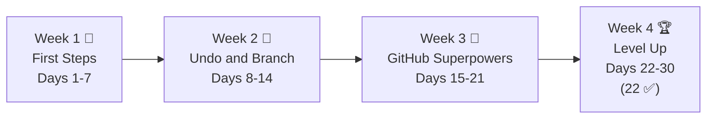
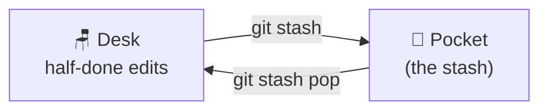

# 🎮 Git Quest: Days 1 to 22 at a Glance

**Created by Rutuja Naik**

Welcome to **Week 4: Level Up**! Weeks 1 to 3 gave you the core skills. Now you pick up the tools that make daily life easier. First up: **`git stash`**, the pocket for unfinished work. This page recaps every day so far and explains Day 22 in detail.

## 🗺️ The journey so far



| Day | Topic | One-line takeaway |
|-----|-------|-------------------|
| 1 | Git vs GitHub | Git saves your work. GitHub shares it. |
| 2 | `git init` and your first commit | A commit is a save point. |
| 3 | The 3 areas of Git | Desk, packing table, cupboard. |
| 4 | `git add` and good commit messages | A message is the label on the box. |
| 5 | `git log` | `HEAD` means "you are here". |
| 6 | `git diff` | Red pen = removed, green pen = added. |
| 7 | Week 1 recap | Put it all together. |
| 8 | `.gitignore` | A "do not pack" list. |
| 9 | `git restore` and `git reset` | Pick the right undo. |
| 10 | `git commit --amend` | Reopen the last box. |
| 11 | What is a branch? | A sticky note on a commit. |
| 12 | `git switch` and `git branch` | Switching swaps your files. |
| 13 | `git merge` | Join two timelines. |
| 14 | Week 2 recap | The branching loop. |
| 15 | Remotes and `git push` | Send commits up to GitHub. |
| 16 | `git clone` | Copy a whole repo from GitHub. |
| 17 | `git fetch` vs `git pull` | Fetch = look. Pull = look and update. |
| 18 | Merge conflicts | When two edits clash, you pick the winner. |
| 19 | Forks | Your own copy of someone else's repo. |
| 20 | Pull requests | Ask for your branch to be merged. |
| 21 | Week 3 recap | The whole GitHub flow. |
| 22 | `git stash` | Pocket your unfinished work, then take it back out. |

## 👖 Day 22 in detail: `git stash`

### The idea

You are halfway through an edit when something urgent appears: a quick fix, a branch to review, a bug to check. Your work is not ready to commit, and a half-finished commit would be messy.

`git stash` puts your **uncommitted changes in a pocket** and gives you a **clean desk** (your files go back to the last commit). When you are ready, you take the work back out of the pocket.



The pocket is a **stack**: the newest stash is on top (`stash@{0}`), and you can keep several.

### The stash toolkit

| Command | What it does |
|---------|--------------|
| `git stash` | Pockets your changes to **tracked** files (staged and unstaged) |
| `git stash push -m "message"` | Same, with a label so you remember what it is |
| `git stash -u` | Also pockets **new (untracked)** files |
| `git stash list` | Shows what is in the pocket |
| `git stash show -p` | Peeks at the changes in the latest stash |
| `git stash pop` | Takes the latest stash **out** and **removes** it from the pocket |
| `git stash apply` | Takes the latest stash out but **keeps** a copy in the pocket |
| `git stash drop` | Throws the latest stash away |

> **`pop` = `apply` + `drop`.** Use `apply` when you want to try the changes on more than one branch.

### Hands-on

```bash
git init -b main stash-lab && cd stash-lab
echo "Pasta" > menu.txt && git add . && git commit -m "Add menu"

# Start some work, but don't commit it
echo "Pizza idea" >> menu.txt
git status                               # modified: menu.txt

# Something urgent! Pocket the work.
git stash push -m "pizza idea"
# Saved working directory and index state On main: pizza idea
git status                               # working tree clean
cat menu.txt                             # Pasta  <- back to the last commit
git stash list
# stash@{0}: On main: pizza idea

# Do the urgent job
echo "Open 9am" > hours.txt && git add . && git commit -m "Add hours"

# Take your work back out
git stash pop
# Changes not staged for commit:  modified: menu.txt
# Dropped refs/stash@{0}
cat menu.txt                             # Pasta, Pizza idea  <- it's back!
```

### New files need `-u`

A plain `git stash` skips **untracked** files (brand-new files Git has never seen):

```bash
echo "notes" > notes.txt                 # new file
echo "Salad" >> menu.txt                 # edit to a tracked file
git stash                                # pockets menu.txt only; notes.txt stays
git stash pop
git stash -u -m "salad and notes"        # pockets both
```

### 🛟 Good to know

- **The stash is local.** It is never pushed to GitHub.
- **Give every stash a message.** `stash@{0}`, `stash@{1}` are hard to tell apart later.
- **Pop can conflict.** If the stashed changes clash with the current files, Git reports a conflict and **keeps the stash**. Fix it like Day 18, then `git stash drop`.
- **Do not hoard.** A pocket full of old stashes is a mess. Finish the work or commit it on a branch.
- **You can pop on a different branch**, which is handy when you started on the wrong one.

## 🧰 Combined cheat sheet (Days 1 to 22)

| Command | What it does | Day |
|---------|--------------|-----|
| `git init -b main` / `git add` / `git commit -m` | Create, pack and save | 2 to 4 |
| `git status` / `git log --oneline --graph` / `git diff` | Look around | 2 to 6 |
| `git restore` / `git reset` / `git commit --amend` | Undo and fix | 9, 10 |
| `git switch -c <name>` / `git merge <branch>` | Branch and merge | 12, 13 |
| `git push` / `git clone` / `git fetch` / `git pull` | Work with GitHub | 15 to 17 |
| Fork, PR | Collaborate | 19, 20 |
| `git stash push -m "msg"` | Pocket unfinished work | 22 |
| `git stash list` | See the pocket | 22 |
| `git stash pop` / `git stash apply` | Take work back out | 22 |
| `git stash -u` | Include new files | 22 |

## 🧠 Day 22 mini quiz

1. What does `git stash` do?
2. What is the difference between `git stash pop` and `git stash apply`?
3. Does a plain `git stash` include brand-new (untracked) files?

<details>
<summary>👀 Click to see the answers</summary>

1. It saves your uncommitted changes in a pocket and restores a clean working tree.
2. `pop` restores and removes the stash. `apply` restores but keeps it.
3. No. Add `-u` to include untracked files.

</details>

## ✅ Skills unlocked so far

- [x] Everything from Weeks 1 to 3 (commits, undo, branches, GitHub, PRs)
- [x] Pocket unfinished work with `git stash`
- [x] List, pop, apply and drop stashes
- [x] Stash new files with `-u`

## 🔜 Coming up in Week 4: Level Up 🏆

| Day | Topic |
|-----|-------|
| 23 | `git rebase` (beginner-safe) |
| 24 | `git cherry-pick` |
| 25 | Tags and releases |
| 26 | `git reflog`: rescue deleted work |
| 27 | Issues and Projects boards |
| 28 | GitHub Actions: your first workflow |
| 29 | GitHub Pages or a profile README |
| 30 | Finale: full cheat sheet and what's next |

## 📌 Your Day 22 commit

| File | Message |
|------|---------|
| `days-1-to-22-summary.md` | `docs(day22): add days 1-22 summary and stash notes` |

---

<p align="center"><i>Progress: 22 / 30 days complete. Pockets full! 🐱</i></p>
