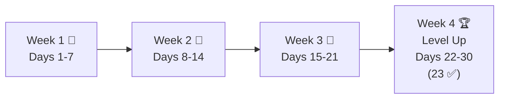
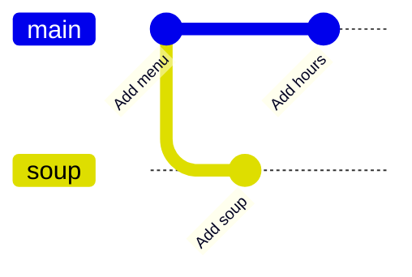

# 🎮 Git Quest: Days 1 to 23 at a Glance

**Created by Rutuja Naik**

Week 4 continues! Yesterday you learned to pocket unfinished work. Today you learned a tidier way to combine branches: **`git rebase`**. This page recaps every day so far and explains Day 23 in detail, the beginner-safe way.

## 🗺️ The journey so far



| Day | Topic | One-line takeaway |
|-----|-------|-------------------|
| 1 | Git vs GitHub | Git saves your work. GitHub shares it. |
| 2 | `git init` and your first commit | A commit is a save point. |
| 3 | The 3 areas of Git | Desk, packing table, cupboard. |
| 4 | `git add` and good commit messages | A message is the label on the box. |
| 5 | `git log` | `HEAD` means "you are here". |
| 6 | `git diff` | Red pen = removed, green pen = added. |
| 7 | Week 1 recap | Put it all together. |
| 8 | `.gitignore` | A "do not pack" list. |
| 9 | `git restore` and `git reset` | Pick the right undo. |
| 10 | `git commit --amend` | Reopen the last box. |
| 11 | What is a branch? | A sticky note on a commit. |
| 12 | `git switch` and `git branch` | Switching swaps your files. |
| 13 | `git merge` | Join two timelines. |
| 14 | Week 2 recap | The branching loop. |
| 15 | Remotes and `git push` | Send commits up to GitHub. |
| 16 | `git clone` | Copy a whole repo from GitHub. |
| 17 | `git fetch` vs `git pull` | Fetch = look. Pull = look and update. |
| 18 | Merge conflicts | When two edits clash, you pick the winner. |
| 19 | Forks | Your own copy of someone else's repo. |
| 20 | Pull requests | Ask for your branch to be merged. |
| 21 | Week 3 recap | The whole GitHub flow. |
| 22 | `git stash` | Pocket unfinished work. |
| 23 | `git rebase` | Re-attach your branch at the newest point for a straight history. |

## 🧵 Day 23 in detail: `git rebase`

### The problem

You branched off `main` to build a feature. While you worked, `main` moved on. Now you want your branch to include the newest `main`. On Day 13 you would **merge**. That works, but it adds a merge commit and a diamond to the history.

### The idea

**Rebase** lifts your branch's commits and **re-attaches them on top of the newest `main`**, as if you had started your work from there. The history becomes a **straight line**.



**Before:** `main` and `soup` forked after *Add menu*.

```bash
git switch soup
git rebase main
```

**After:** `soup`'s commit sits on top of *Add hours*, in one straight line:

```text
* c8d3e57 (HEAD -> soup) Add soup
* 6b2e9f1 (main) Add hours
* a09f5c2 Add menu
```

> 🔎 **Under the hood:** Git does not move your commits. It makes **new copies** with **new hashes** on the new base and abandons the old ones. (Like `--amend` on Day 10, but for a whole branch.)

### Merge vs rebase

| | 🔀 Merge | 🧵 Rebase |
|---|----------|-----------|
| **History** | Kept as it happened, with a merge commit (a diamond) | A straight line |
| **Commit hashes** | Unchanged | **New** hashes for your commits |
| **Safe on shared branches?** | ✅ Yes | ⚠️ **No** |
| **Best for** | Joining shared work | Tidying **your own** branch |

### ⚠️ The golden rule

**Never rebase commits that other people already have** (anything pushed to a shared branch such as `main`). Rewriting shared history confuses everyone. Rebase your **own local branch**, before you share it.

### Hands-on

```bash
git init -b main rebase-lab && cd rebase-lab
echo "Pasta" > menu.txt && git add . && git commit -m "Add menu"

git switch -c soup
echo "Soup" > soup.txt && git add . && git commit -m "Add soup"

git switch main
echo "Mon-Fri 9am" > hours.txt && git add . && git commit -m "Add hours"

git log --oneline --graph --all
# * 6b2e9f1 (HEAD -> main) Add hours
# | * 3d7c1a4 (soup) Add soup
# |/
# * a09f5c2 Add menu                     <- a fork

git switch soup
git rebase main
# Successfully rebased and updated refs/heads/soup.

git log --oneline --graph --all
# * c8d3e57 (HEAD -> soup) Add soup      <- new hash! (was 3d7c1a4)
# * 6b2e9f1 (main) Add hours
# * a09f5c2 Add menu                     <- a straight line

git switch main
git merge soup
# Updating 6b2e9f1..c8d3e57
# Fast-forward
git branch -d soup
```

Because `soup` now sits right on top of `main`, merging it is a clean **fast-forward** (Day 13): no merge commit at all.

### If the rebase hits a conflict

Rebase replays your commits **one at a time**, so it may stop at one that clashes (same idea as Day 18).

1. `git status` shows which file conflicts.
2. Edit the file and remove the markers.
3. `git add <file>`
4. `git rebase --continue`

Want out? **`git rebase --abort`** puts everything back exactly as it was.

### 🛟 Good to know

- **Make a safety copy first:** `git branch backup` before a rebase you are nervous about.
- **`git reflog`** (Day 26) can rescue commits even after a rebase.
- **`git rebase --skip`** drops the commit that is currently conflicting.
- **A peek ahead:** `git rebase -i` ("interactive") lets you squash, reword or reorder commits. It is powerful, so save it until you are comfortable.
- **Not sure? Merge.** Merging is always safe.

## 🧰 Combined cheat sheet (Days 1 to 23)

| Command | What it does | Day |
|---------|--------------|-----|
| `git init -b main` / `git add` / `git commit -m` | Create, pack and save | 2 to 4 |
| `git status` / `git log --oneline --graph` / `git diff` | Look around | 2 to 6 |
| `git restore` / `git reset` / `git commit --amend` | Undo and fix | 9, 10 |
| `git switch -c <name>` / `git merge <branch>` | Branch and merge | 12, 13 |
| `git push` / `git clone` / `git fetch` / `git pull` | Work with GitHub | 15 to 17 |
| Fork, PR | Collaborate | 19, 20 |
| `git stash` / `git stash pop` | Pocket unfinished work | 22 |
| `git rebase main` | Replay my branch on top of main | 23 |
| `git rebase --continue` / `--abort` | Carry on / cancel after a conflict | 23 |

## 🧠 Day 23 mini quiz

1. What does `git rebase main` do to your branch?
2. Why do rebased commits get new hashes?
3. When should you **not** rebase?

<details>
<summary>👀 Click to see the answers</summary>

1. It replays your branch's commits on top of the latest `main`, giving a straight history.
2. Git creates new copies of the commits on the new base. The old ones are abandoned.
3. When the commits are already shared (pushed) and other people use them.

</details>

## ✅ Skills unlocked so far

- [x] Everything from Weeks 1 to 3 (commits, undo, branches, GitHub, PRs)
- [x] Pocket unfinished work with `git stash`
- [x] Rebase your own branch onto `main`
- [x] Explain merge vs rebase and the golden rule
- [x] Continue or abort a rebase

## 🔜 Coming up in Week 4: Level Up 🏆

| Day | Topic |
|-----|-------|
| 24 | `git cherry-pick` |
| 25 | Tags and releases |
| 26 | `git reflog`: rescue deleted work |
| 27 | Issues and Projects boards |
| 28 | GitHub Actions: your first workflow |
| 29 | GitHub Pages or a profile README |
| 30 | Finale: full cheat sheet and what's next |

## 📌 Your Day 23 commit

| File | Message |
|------|---------|
| `days-1-to-23-summary.md` | `docs(day23): add days 1-23 summary and rebase notes` |

---

<p align="center"><i>Progress: 23 / 30 days complete. Straight lines only! 🐱</i></p>
