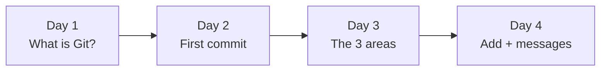

# 🎮 Git Quest: Days 1 to 4 at a Glance

**Created by Rutuja Naik**

Four days in, you can already create a repository, stage files and save clear commits. This page explains what each day covered and how the days connect.

## 🗺️ The big picture

| Day | Topic | One-line takeaway | Key commands | Folder |
|-----|-------|-------------------|--------------|--------|
| 1 | Git vs GitHub | Git saves your work. GitHub shares it. | `git --version`, `git config` | [day01-intro](./day01-intro) |
| 2 | `git init` and your first commit | `git init` opens a save slot; a commit is a save point. | `git init`, `git status`, `git add`, `git commit`, `git log` | [day02-first-commit](./day02-first-commit) |
| 3 | The 3 areas of Git | Every file is on the desk, the packing table or in the cupboard. | `git status`, `git add`, `git commit`, `git restore --staged` | [day03-three-areas](./day03-three-areas) |
| 4 | `git add` and good commit messages | A commit message is the label on the box. Make it count. | `git add .`, `git commit -m "summary" -m "body"`, `git log --oneline` | [day04-commit-messages](./day04-commit-messages) |

## 📖 Day by day

### Day 1: Git vs GitHub
You met the two tools. **Git** is the save-game system on your computer, and **GitHub** is the website where saves are stored and shared. You installed Git, introduced yourself with `git config`, and created the `git-quest` repo on GitHub.

### Day 2: `git init` and your first commit
You turned a plain folder into a repository with `git init`, created a file, and made your first commit from the terminal. You learned that `.git` is the hidden vault holding every save point, and that `git log` shows them.

### Day 3: The 3 areas of Git
You learned the idea behind everything else: **working directory** (your desk), **staging area** (the packing table) and **repository** (the cupboard). `git add` moves a file from the desk to the table, and `git commit` seals it into the cupboard. You also learned to read `git status` like a traffic light.

### Day 4: `git add` and good commit messages
You learned several ways to stage files (one, many, or all), and how to write labels that make sense months later: short summary, starts with a verb, no full stop, one change per commit. You can add a longer body with a second `-m`.

## 🧰 Combined cheat sheet (Days 1 to 4)

| Command | What it does | Day |
|---------|--------------|-----|
| `git --version` | Checks that Git is installed | 1 |
| `git config --global user.name "Name"` | Tells Git who you are | 1 |
| `git init -b main` | Creates a repository in this folder | 2 |
| `git status` | Shows which area each file is in | 2, 3 |
| `git add <file>` | Desk → packing table | 2, 3, 4 |
| `git add .` | Stages every change in this folder | 4 |
| `git commit -m "message"` | Packing table → cupboard | 2, 3, 4 |
| `git commit -m "summary" -m "body"` | Commit with a longer note | 4 |
| `git restore --staged <file>` | Take a file off the packing table | 3 |
| `git log --oneline` | Shows your history, one line per commit | 2, 4 |

## ✅ Skills unlocked

- [x] Explain Git vs GitHub in one sentence
- [x] Create a repository with `git init`
- [x] Name the 3 areas and move files between them
- [x] Stage one file, several files, or everything
- [x] Write a clear commit message
- [x] Read your history with `git log --oneline`

## 🔜 Coming up in Week 1

| Day | Topic |
|-----|-------|
| 5 | `git log`, your time machine |
| 6 | `git diff`, spot the difference |
| 7 | Week 1 recap, quiz and cheat sheet |

---

<i>Progress: 4 / 30 days complete. Keep going! 🐱</i>

