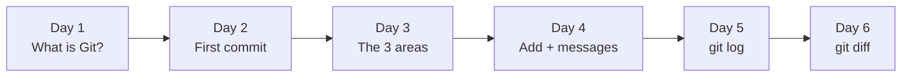

# 🎮 Git Quest: Days 1 to 6 at a Glance

**Created by Rutuja Naik**

Five days in, you can create a repository, stage files, write clear commits and read your own history. This page explains what each day covered and how the days connect.

## 🗺️ The big picture

| Day | Topic | One-line takeaway | Key commands | Folder |
|-----|-------|-------------------|--------------|--------|
| 1 | Git vs GitHub | Git saves your work. GitHub shares it. | `git --version`, `git config` | [day01-intro](./day01-intro) |
| 2 | `git init` and your first commit | `git init` opens a save slot; a commit is a save point. | `git init`, `git status`, `git add`, `git commit`, `git log` | [day02-first-commit](./day02-first-commit) |
| 3 | The 3 areas of Git | Every file is on the desk, the packing table or in the cupboard. | `git status`, `git add`, `git commit`, `git restore --staged` | [day03-three-areas](./day03-three-areas) |
| 4 | `git add` and good commit messages | A commit message is the label on the box. Make it count. | `git add .`, `git commit -m "summary" -m "body"` | [day04-commit-messages](./day04-commit-messages) |
| 5 | `git log`, your time machine | `git log` lists every save point, newest first. `HEAD` means "you are here". | `git log --oneline`, `--stat`, `--graph`, `--grep`, `git show` | [day05-git-log](./day05-git-log) |
| 6 | `git diff`, spot the difference | Red pen = removed, green pen = added. Compare desk, packing table, cupboard or two commits. | `git diff`, `--staged`, `HEAD`, `--stat` | [day06-git-diff](./day06-git-diff) |

## 📖 Day by day

### Day 1: Git vs GitHub
You met the two tools. **Git** is the save-game system on your computer, and **GitHub** is the website where saves are stored and shared. You installed Git, introduced yourself with `git config`, and created the `git-quest` repo on GitHub.

### Day 2: `git init` and your first commit
You turned a plain folder into a repository with `git init`, created a file, and made your first commit from the terminal. You learned that `.git` is the hidden vault holding every save point.

### Day 3: The 3 areas of Git
You learned the idea behind everything else: **working directory** (your desk), **staging area** (the packing table) and **repository** (the cupboard). `git add` moves a file from the desk to the table, and `git commit` seals it into the cupboard. You also learned to read `git status` like a traffic light.

### Day 4: `git add` and good commit messages
You learned several ways to stage files (one, many, or all), and how to write labels that make sense months later: short summary, starts with a verb, no full stop, one change per commit.

### Day 5: `git log`, your time machine
You learned to read your history. `git log` shows every commit, and flags such as `--oneline`, `-n`, `--stat` and `--graph` let you zoom in and out. You met the **hash** (a commit's ID) and **HEAD** (the "you are here" pin), searched with `--grep`, and opened a single commit with `git show`.

### Day 6: `git diff`, spot the difference
You learned to see exactly what changed. `git diff` compares your desk with the packing table, `git diff --staged` compares the packing table with the cupboard (your last check before committing), and `git diff HEAD~1 HEAD` compares two save points. You read a diff: `-` lines were removed, `+` lines were added.

## 🧰 Combined cheat sheet (Days 1 to 6)

| Command | What it does | Day |
|---------|--------------|-----|
| `git --version` | Checks that Git is installed | 1 |
| `git config --global user.name "Name"` | Tells Git who you are | 1 |
| `git init -b main` | Creates a repository in this folder | 2 |
| `git status` | Shows which area each file is in | 2, 3 |
| `git add <file>` | Desk → packing table | 2, 3, 4 |
| `git add .` | Stages every change in this folder | 4 |
| `git commit -m "message"` | Packing table → cupboard | 2, 3, 4 |
| `git commit -m "summary" -m "body"` | Commit with a longer note | 4 |
| `git restore --staged <file>` | Take a file off the packing table | 3 |
| `git log --oneline` | History, one line per commit | 2, 4, 5 |
| `git log --stat` | History plus the files each commit touched | 5 |
| `git log --graph --oneline` | History drawn as a map | 5 |
| `git log --grep="word"` | Search commit messages | 5 |
| `git show <hash>` | Open one commit in detail | 5 |
| `git diff` | Desk vs packing table: unstaged changes | 6 |
| `git diff --staged` | Packing table vs cupboard: what you will commit | 6 |
| `git diff HEAD~1 HEAD` | Compare the last two commits | 6 |
| `git diff --stat` | Short summary of changes | 6 |

## ✅ Skills unlocked

- [x] Explain Git vs GitHub in one sentence
- [x] Create a repository with `git init`
- [x] Name the 3 areas and move files between them
- [x] Stage one file, several files, or everything
- [x] Write a clear commit message
- [x] Read, search and zoom through your history
- [x] Open a single commit with `git show`
- [x] Read a diff and tell removed lines from added lines

## 🔜 Coming up next

| Day | Topic |
|-----|-------|
| 7 | Week 1 recap, quiz and cheat sheet |

---

<i>Progress: 6 / 30 days complete. Keep going! 🐱</i>

