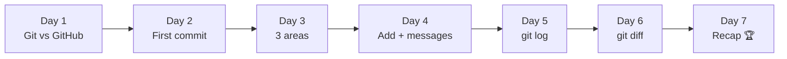
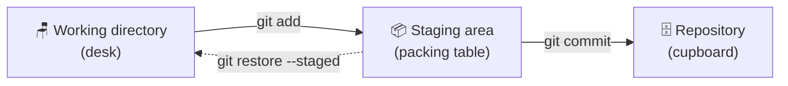

# 🏆 Git Quest: Week 1 Recap (Days 1 to 7)

**Created by Rutuja Naik**

Week 1 is complete! In seven days you went from "What is Git?" to creating repositories, saving clear commits, reading your history and spotting every change. This page recaps the whole week, gives you a cheat sheet, a quiz and one final quest.

## 🗺️ Your Week 1 journey



| Day | Topic | One-line takeaway | Key commands | Folder |
|-----|-------|-------------------|--------------|--------|
| 1 | Git vs GitHub | Git saves your work. GitHub shares it. | `git --version`, `git config` | [day01-intro](./day01-intro) |
| 2 | `git init` and your first commit | `git init` opens a save slot; a commit is a save point. | `git init`, `git status`, `git add`, `git commit`, `git log` | [day02-first-commit](./day02-first-commit) |
| 3 | The 3 areas of Git | Every file is on the desk, the packing table or in the cupboard. | `git status`, `git add`, `git commit`, `git restore --staged` | [day03-three-areas](./day03-three-areas) |
| 4 | `git add` and good commit messages | A commit message is the label on the box. | `git add .`, `git commit -m "summary" -m "body"` | [day04-commit-messages](./day04-commit-messages) |
| 5 | `git log`, your time machine | `git log` lists every save point. `HEAD` means "you are here". | `git log --oneline`, `--stat`, `--graph`, `git show` | [day05-git-log](./day05-git-log) |
| 6 | `git diff`, spot the difference | Red pen = removed, green pen = added. | `git diff`, `--staged`, `HEAD~1 HEAD`, `--stat` | [day06-git-diff](./day06-git-diff) |
| 7 | Week 1 recap | Put it all together. | Everything above | You are here 🏆 |

## 🧠 The big picture in one diagram



**Look-around commands** work alongside this flow:

| Command | Answers the question |
|---------|----------------------|
| `git status` | Which area is each file in? |
| `git diff` | What did I change but not pack yet? |
| `git diff --staged` | What am I about to commit? |
| `git log --oneline` | What is my history? |
| `git show <hash>` | What is inside this one commit? |

## 🔁 The daily loop

```bash
git status                    # 1. Where are my files?
git add <file>                # 2. Pack what belongs together
git diff --staged             # 3. Last check before saving
git commit -m "Add menu"      # 4. Seal it with a clear label
git log --oneline             # 5. Admire your history
```

## 🧰 Week 1 cheat sheet

| Group | Command | What it does |
|-------|---------|--------------|
| **Setup** | `git --version` | Checks that Git is installed |
| | `git config --global user.name "Name"` | Tells Git who you are |
| | `git init -b main` | Creates a repository in this folder |
| **Daily loop** | `git status` | Shows which area each file is in |
| | `git add <file>` / `git add .` | Desk → packing table |
| | `git commit -m "message"` | Packing table → cupboard |
| | `git commit -m "summary" -m "body"` | Commit with a longer note |
| **Look around** | `git log --oneline` | History, one line per commit |
| | `git log --stat` | History plus files touched |
| | `git show <hash>` | Open one commit |
| | `git diff` | Desk vs packing table |
| | `git diff --staged` | Packing table vs cupboard |
| | `git diff HEAD~1 HEAD` | Compare the last two commits |
| **Undo (so far)** | `git restore --staged <file>` | Take a file off the packing table |

## 📝 Boss quiz (10 questions)

1. What is the difference between Git and GitHub?
2. Which command turns a folder into a repository?
3. Name the 3 areas of Git.
4. Which command moves a file from the desk to the packing table?
5. What makes a good commit message?
6. What does `HEAD` mean?
7. Which command shows one line per commit?
8. In `git diff`, what does a line starting with `+` mean?
9. Which command shows what you are about to commit?
10. How do you leave the log screen when it opens?

<details>
<summary>👀 Click to see the answers</summary>

1. Git saves your work on your computer. GitHub is the website that stores and shares it.
2. `git init`
3. Working directory (desk), staging area (packing table), repository (cupboard).
4. `git add`
5. Short, starts with a verb, no full stop, and covers one logical change.
6. The commit you are currently on: the "you are here" pin.
7. `git log --oneline`
8. The line was added.
9. `git diff --staged`
10. Press `q`.

</details>

## 🎯 Final quest: build it from scratch

Without looking at the lessons, do this in a fresh folder:

```bash
git init -b main week1-final && cd week1-final
echo "One" > a.txt && echo "Two" > b.txt
git status
git add a.txt
git diff --staged
git commit -m "Add file a"
git add b.txt && git commit -m "Add file b"
git log --oneline
```

**Success looks like:** two commits, each with a clear message, and a `git log --oneline` that reads like a short story.

## ✅ Skills unlocked in Week 1

- [x] Explain Git vs GitHub in one sentence
- [x] Create a repository with `git init`
- [x] Name the 3 areas and move files between them
- [x] Stage one file, several files, or everything
- [x] Write a clear commit message
- [x] Read, search and zoom through your history
- [x] Compare changes with `git diff`
- [x] Run the daily loop without looking at notes

## 🔜 Coming up in Week 2: Undo and Branch 🌿

| Day | Topic |
|-----|-------|
| 8 | `.gitignore`: tell Git which files to skip |
| 9 | `git restore` and `git reset`: oops, undo! |
| 10 | `git commit --amend`: fix your last commit |
| 11 | What is a branch? |
| 12 | `git switch` and `git branch` |
| 13 | `git merge` |
| 14 | Week 2 recap: Branch Adventure |

---

<p align="center"><i>Progress: 7 / 30 days complete. Week 1 done, keep going! 🐱</i></p>
