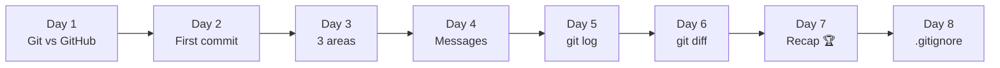
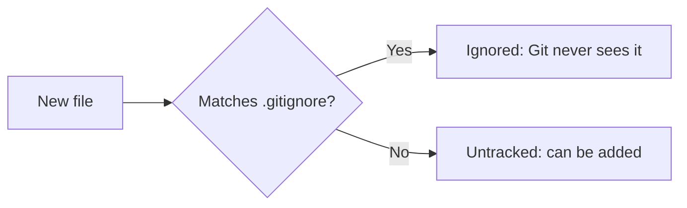

# 🎮 Git Quest: Days 1 to 8 at a Glance

**Created by Rutuja Naik**

Week 1 is done and Week 2 (Undo and Branch) has begun. Today you learned how to keep junk and secrets out of your repository with `.gitignore`. This page recaps every day so far and explains Day 8 in detail.

## 🗺️ The journey so far



| Day | Topic | One-line takeaway | Key commands |
|-----|-------|-------------------|--------------|
| 1 | Git vs GitHub | Git saves your work. GitHub shares it. | `git --version`, `git config` |
| 2 | `git init` and your first commit | `git init` opens a save slot; a commit is a save point. | `git init`, `git status`, `git commit` |
| 3 | The 3 areas of Git | Desk, packing table, cupboard. | `git add`, `git commit`, `git restore --staged` |
| 4 | `git add` and good commit messages | A message is the label on the box. | `git add .`, `git commit -m "summary" -m "body"` |
| 5 | `git log`, your time machine | `HEAD` means "you are here". | `git log --oneline`, `--stat`, `git show` |
| 6 | `git diff`, spot the difference | Red pen = removed, green pen = added. | `git diff`, `--staged`, `HEAD~1 HEAD` |
| 7 | Week 1 recap | Put it all together. | The daily loop |
| 8 | `.gitignore` | A "do not pack" list for files Git should skip. | `.gitignore`, `git status --ignored`, `git rm --cached` |

## 🚫 Day 8 in detail: `.gitignore`

### The idea

Some files should never travel with your project: passwords, logs, build output and system junk. A file called **`.gitignore`** is your **"do not pack" list**. Git reads it and quietly skips every file that matches, so it never shows up in `git status` and never gets staged by `git add .`.



### What to ignore

| Kind of file | Examples |
|--------------|----------|
| 🔐 Secrets | `secret.txt`, `.env`, API keys |
| 🏗️ Build output and dependencies | `build/`, `dist/`, `node_modules/` |
| 📜 Logs and temp files | `*.log`, `*.tmp` |
| 💻 System and editor files | `.DS_Store`, `Thumbs.db`, `.vscode/` |

### Pattern cheat sheet

| Pattern | Matches |
|---------|---------|
| `secret.txt` | Exactly that file |
| `*.log` | Every file ending in `.log` |
| `build/` | The whole `build` folder |
| `/todo.txt` | Only `todo.txt` in the top folder |
| `!keep.log` | Exception: track this one anyway |
| `# comment` | A note to yourself |

### Hands-on in 6 commands

```bash
git init -b main ignore-lab && cd ignore-lab
echo "My notes" > notes.txt
echo "password=1234" > secret.txt
echo "debug" > app.log
mkdir build && echo "out" > build/result.txt
git status                                    # 4 untracked items, including secret.txt!
printf "secret.txt\n*.log\nbuild/\n" > .gitignore
git status                                    # only .gitignore and notes.txt remain
git add . && git commit -m "Add notes and .gitignore"
git status --ignored                          # see what Git is skipping
```

### The gotcha: files Git already tracks

`.gitignore` only affects files Git is **not tracking yet**. If you committed a file first and ignored it later, Git keeps tracking it. Fix:

```bash
git rm --cached scratch.txt
git commit -m "Stop tracking scratch.txt"
```

`--cached` removes it from Git but **keeps the file on your disk**.

> ⚠️ If a password was ever committed, ignoring it later is not enough: it still lives in your history. Change the password.

### Detective tool

```bash
git check-ignore -v app.log
# .gitignore:2:*.log    app.log
```

Tells you which rule is ignoring a file. Ready-made lists for every language live at [github.com/github/gitignore](https://github.com/github/gitignore).

## 🧰 Combined cheat sheet (Days 1 to 8)

| Command | What it does | Day |
|---------|--------------|-----|
| `git --version` | Checks that Git is installed | 1 |
| `git config --global user.name "Name"` | Tells Git who you are | 1 |
| `git init -b main` | Creates a repository in this folder | 2 |
| `git status` | Which area is each file in? | 2, 3 |
| `git add <file>` / `git add .` | Desk → packing table | 2 to 4 |
| `git commit -m "message"` | Packing table → cupboard | 2 to 4 |
| `git restore --staged <file>` | Take a file off the packing table | 3 |
| `git log --oneline` | History, one line per commit | 5 |
| `git show <hash>` | Open one commit | 5 |
| `git diff` / `git diff --staged` | Compare desk, table, cupboard | 6 |
| `git status --ignored` | Show ignored files too | 8 |
| `git check-ignore -v <file>` | Which rule ignores this file? | 8 |
| `git rm --cached <file>` | Stop tracking a file but keep it | 8 |

## 🧠 Day 8 mini quiz

1. What does `*.log` match?
2. You ignored a file but Git still tracks it. How do you fix it?
3. Which kind of file should you never commit?

<details>
<summary>👀 Click to see the answers</summary>

1. Every file whose name ends in `.log`.
2. `git rm --cached <file>`, then commit.
3. Passwords, keys and `.env` secrets.

</details>

## ✅ Skills unlocked so far

- [x] Everything from Week 1 (repos, the 3 areas, commits, log, diff)
- [x] Write a `.gitignore` with exact names, wildcards and folders
- [x] Check what Git is ignoring and why
- [x] Stop tracking a file that was committed by mistake

## 🔜 Coming up in Week 2: Undo and Branch 🌿

| Day | Topic |
|-----|-------|
| 9 | `git restore` and `git reset`: oops, undo! |
| 10 | `git commit --amend`: fix your last commit |
| 11 | What is a branch? |
| 12 | `git switch` and `git branch` |
| 13 | `git merge` |
| 14 | Week 2 recap: Branch Adventure |

## 📌 Your Day 8 commit

| File | Message |
|------|---------|
| `days-1-to-8-summary.md` | `docs(day08): add days 1-8 summary and gitignore notes` |

---

<p align="center"><i>Progress: 8 / 30 days complete. Week 2 has begun! 🐱</i></p>
