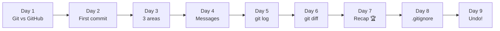
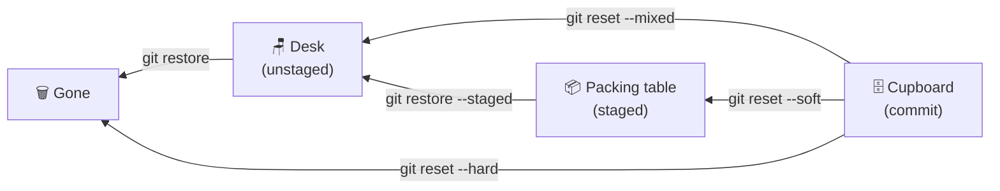

# 🎮 Git Quest: Days 1 to 9 at a Glance

**Created by Rutuja Naik**

Week 2 is about **Undo and Branch**. Yesterday you learned to keep junk out with `.gitignore`. Today you learned the most reassuring skill in Git: how to take things back. This page recaps every day so far and explains Day 9 in detail.

## 🗺️ The journey so far



| Day | Topic | One-line takeaway | Key commands |
|-----|-------|-------------------|--------------|
| 1 | Git vs GitHub | Git saves your work. GitHub shares it. | `git --version`, `git config` |
| 2 | `git init` and your first commit | `git init` opens a save slot; a commit is a save point. | `git init`, `git status`, `git commit` |
| 3 | The 3 areas of Git | Desk, packing table, cupboard. | `git add`, `git commit`, `git restore --staged` |
| 4 | `git add` and good commit messages | A message is the label on the box. | `git add .`, `git commit -m "summary" -m "body"` |
| 5 | `git log`, your time machine | `HEAD` means "you are here". | `git log --oneline`, `git show` |
| 6 | `git diff`, spot the difference | Red pen = removed, green pen = added. | `git diff`, `--staged`, `HEAD~1 HEAD` |
| 7 | Week 1 recap | Put it all together. | The daily loop |
| 8 | `.gitignore` | A "do not pack" list. | `.gitignore`, `git rm --cached` |
| 9 | `git restore` and `git reset` | Mistakes are fixable, if you pick the right undo. | `git restore`, `git reset --soft / --mixed / --hard` |

## ↩️ Day 9 in detail: oops, undo!

### The idea

Every undo in Git moves something **backwards** through the 3 areas you already know:



### `git restore`: fix files

| Command | What it does | Safe? |
|---------|--------------|-------|
| `git restore --staged <file>` | Packing table → desk. Your edits stay. | ✅ Safe |
| `git restore <file>` | **Throws away** your unsaved edits and brings back the last saved version. | ⚠️ Cannot be undone |
| `git restore --source=HEAD~1 <file>` | Brings back the file as it was one commit ago. | ✅ Safe (it becomes a new edit) |

### `git reset`: fix commits

`git reset HEAD~1` takes the **last commit out of the cupboard**. The three modes decide where its changes end up:

| Mode | Command | Commit | Changes end up... |
|------|---------|--------|-------------------|
| Soft | `git reset --soft HEAD~1` | Undone | 📦 Staged on the packing table |
| Mixed (default) | `git reset HEAD~1` | Undone | 🪑 Unstaged on the desk |
| Hard | `git reset --hard HEAD~1` | Undone | 🗑️ **Deleted** |

### Which undo do I need?

| Situation | Use |
|-----------|-----|
| I edited a file and want those edits gone | `git restore <file>` ⚠️ |
| I staged the wrong file | `git restore --staged <file>` |
| I committed too early but want to keep my work | `git reset --soft HEAD~1` |
| I committed junk and want it gone completely | `git reset --hard HEAD~1` ⚠️ |

### Hands-on

```bash
git init -b main undo-lab && cd undo-lab
echo "Line 1" > story.txt
git add story.txt && git commit -m "Add story"

# A. Throw away a bad edit
echo "Oops, wrong line" >> story.txt
git restore story.txt                 # story.txt is back to "Line 1"

# B. Unstage without losing work
echo "Line 2" >> story.txt
git add story.txt
git restore --staged story.txt        # edit kept, back on the desk

# C. Undo a commit (soft)
git add . && git commit -m "Add line 2"
git reset --soft HEAD~1               # commit gone, change still staged
git status
```

### 🛟 Safety rules

1. **Look first:** run `git status` and `git diff` so you know exactly what you will lose.
2. `git restore <file>` and `git reset --hard` **cannot be undone** for work you never committed.
3. Only reset commits that are still **on your computer**. Once you share commits (Week 3), rewriting them causes trouble for others.
4. Committed work that was reset can usually still be rescued with `git reflog` (Day 26).

## 🧰 Combined cheat sheet (Days 1 to 9)

| Command | What it does | Day |
|---------|--------------|-----|
| `git init -b main` | Creates a repository | 2 |
| `git status` | Which area is each file in? | 2, 3 |
| `git add <file>` / `git add .` | Desk → packing table | 2 to 4 |
| `git commit -m "message"` | Packing table → cupboard | 2 to 4 |
| `git log --oneline` / `git show <hash>` | Read your history | 5 |
| `git diff` / `git diff --staged` | Compare desk, table, cupboard | 6 |
| `git status --ignored` / `git rm --cached <file>` | Manage ignored and tracked files | 8 |
| `git restore --staged <file>` | Packing table → desk | 3, 9 |
| `git restore <file>` | Discard edits ⚠️ | 9 |
| `git reset --soft HEAD~1` | Undo commit, keep staged | 9 |
| `git reset HEAD~1` | Undo commit, keep on desk | 9 |
| `git reset --hard HEAD~1` | Undo commit, delete changes ⚠️ | 9 |

## 🧠 Day 9 mini quiz

1. Which command throws away unstaged edits in a file?
2. What is the difference between `reset --soft` and `reset --hard`?
3. Which is safe: `git restore --staged` or `git restore`?

<details>
<summary>👀 Click to see the answers</summary>

1. `git restore <file>`
2. `--soft` keeps the changes staged. `--hard` deletes them.
3. `git restore --staged` is safe (your edits stay). Plain `git restore` discards edits.

</details>

## ✅ Skills unlocked so far

- [x] Everything from Week 1 (repos, the 3 areas, commits, log, diff)
- [x] Write a `.gitignore` and stop tracking files
- [x] Unstage a file without losing work
- [x] Discard edits you do not want
- [x] Undo a commit with `--soft`, `--mixed` or `--hard`

## 🔜 Coming up in Week 2: Undo and Branch 🌿

| Day | Topic |
|-----|-------|
| 10 | `git commit --amend`: fix your last commit |
| 11 | What is a branch? |
| 12 | `git switch` and `git branch` |
| 13 | `git merge` |
| 14 | Week 2 recap: Branch Adventure |

## 📌 Your Day 9 commit

| File | Message |
|------|---------|
| `days-1-to-9-summary.md` | `docs(day09): add days 1-9 summary and undo notes` |

---

<p align="center"><i>Progress: 9 / 30 days complete. Oops-proof! 🐱</i></p>
