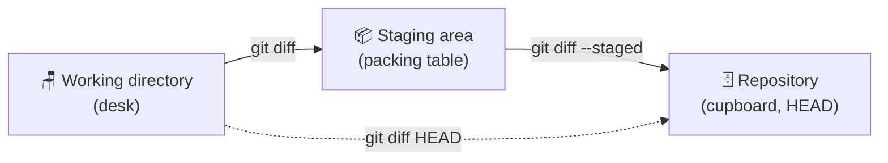

# 🔍 Day 6: `git diff`, Spot the Difference


> **Yesterday:** you travelled back in time with `git log`.
> **Today:** you learn to see *exactly what changed*. `git diff` is the "spot the difference" puzzle of Git.

---

## 🎯 Today's mission

By the end of this lesson you will be able to:

- Use `git diff` to see changes you have not staged yet
- Use `git diff --staged` to see what is about to be committed
- Compare two commits
- Read a diff: which lines were removed, which were added

## 🐱 The analogy: red pen and green pen

Imagine an editor checking your homework with two pens:

- 🔴 **Red pen** crosses out what was **removed**
- 🟢 **Green pen** writes in what was **added**

`git diff` does exactly that for your files, and it can compare any two of the places you learned about on Day 3.



| Command | Compares | Question it answers |
|---------|----------|---------------------|
| `git diff` | Desk vs packing table | What did I change but not pack yet? |
| `git diff --staged` | Packing table vs cupboard | What am I about to commit? |
| `git diff HEAD` | Desk vs cupboard | Everything I changed since my last save |
| `git diff A B` | Two save points | What changed between these commits? |

## 🛠️ Part 1: set up a tiny recipe

```bash
git init -b main spot-diff
cd spot-diff
printf "Pasta\nTomato sauce\nBasil\n" > recipe.txt
git add recipe.txt
git commit -m "Add recipe"
```

## 👀 Part 2: spot the difference

### Step 1: change the file

```bash
printf "Pasta\nPesto sauce\nBasil\nCheese\n" > recipe.txt
git status
```

```text
Changes not staged for commit:
        modified:   recipe.txt
```

### Step 2: see what changed

```bash
git diff
```

```text
diff --git a/recipe.txt b/recipe.txt
index 3f1a2b4..8c9d0e5 100644
--- a/recipe.txt
+++ b/recipe.txt
@@ -1,3 +1,4 @@
 Pasta
-Tomato sauce
+Pesto sauce
 Basil
+Cheese
```

### How to read it

| Part | Meaning |
|------|---------|
| `--- a/recipe.txt` | The **old** version (what Git last saved) |
| `+++ b/recipe.txt` | The **new** version (what is on your desk) |
| `@@ -1,3 +1,4 @@` | Location: the old file showed 3 lines from line 1, the new one shows 4 |
| `-Tomato sauce` | 🔴 This line was **removed** |
| `+Pesto sauce` | 🟢 This line was **added** |
| ` Pasta` (starts with a space) | Unchanged line, shown for context |

> 💡 A changed line always appears as one `-` line and one `+` line: the old text out, the new text in.

### Step 3: pack it, then look again

```bash
git add recipe.txt
git diff
```

Nothing appears. 😮 That is correct: the changes moved from the desk to the packing table, so there is no difference *between those two* any more. Now ask about the packing table:

```bash
git diff --staged
```

You see the same diff again. This is your **last check before committing**.

### Step 4: commit and compare two saves

```bash
git commit -m "Switch to pesto and add cheese"
git diff HEAD~1 HEAD
```

`HEAD` is the newest commit and `HEAD~1` is the one before it. You see the same changes, now as a comparison between two save points.

### Step 5: get a short summary

```bash
git diff --stat HEAD~1 HEAD
```

```text
 recipe.txt | 3 ++-
 1 file changed, 2 insertions(+), 1 deletion(-)
```

## 🌟 Bonus: word-level diff

```bash
git diff --word-diff
```

```text
Pasta
[-Tomato-]{+Pesto+} sauce
Basil
{+Cheese+}
```

Perfect when only a word or two changed in a long line.

## 🎬 Watch it happen


> Generated from [`demo.tape`](./demo.tape) using [VHS](https://github.com/charmbracelet/vhs).

## 🧰 Cheat sheet

| Command | What it does |
|---------|--------------|
| `git diff` | Desk vs packing table |
| `git diff --staged` | Packing table vs cupboard (what you will commit) |
| `git diff HEAD` | Desk vs cupboard (all uncommitted changes) |
| `git diff HEAD~1 HEAD` | Compare the last two commits |
| `git diff --stat` | Short summary of changed files |
| `git diff <file>` | Show changes in one file only |
| `git diff --word-diff` | Highlight changed words |

## 🆘 Common problems

| You see | What it means | Fix |
|---------|---------------|-----|
| `git diff` prints nothing | The changes are already staged, or nothing changed | Try `git diff --staged`, or edit the file |
| A new file is missing from `git diff` | Untracked files are not shown | Run `git add <file>`, then `git diff --staged` |
| Screen stuck with `(END)` | Git opened a scrolling screen | Press `q` |

## ✅ Your turn

Head to [`exercise.md`](./exercise.md) and play spot the difference.

---

⬅️ [Day 5: git log, your time machine](../day05-git-log) | ➡️ **Day 7: Week 1 recap, quiz and cheat sheet** *(coming tomorrow)*
