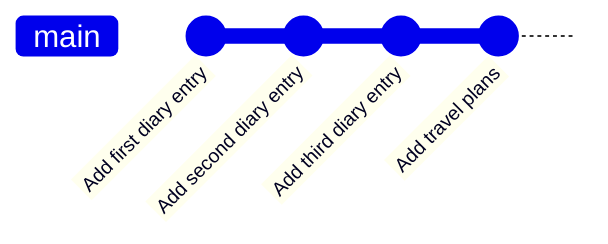

# ⏳ Day 5: `git log`, Your Time Machine


> **Yesterday:** you learned to write clear labels for your save points.
> **Today:** you learn to **travel back** and read them. `git log` is the time machine of Git.

---

## 🎯 Today's mission

By the end of this lesson you will be able to:

- Read the full output of `git log`
- Use `--oneline`, `-n`, `--stat` and `--graph` to zoom in and out
- Search your history with `--grep`
- Open a single commit with `git show`
- Escape the log screen without panicking 😅

## 🐱 The analogy: the time machine

Every commit is a save point on a timeline. `git log` is the dashboard of your time machine: it lists every save point, **newest first**, so you can see where you have been.



The newest commit is marked **HEAD**, a pin that says **"you are here"**.

## 🔍 Part 1: reading one log entry

```text
commit e41b7a9c3d1f2a8b6e0c5d4f7a9b1c2d3e4f5a6b (HEAD -> main)
Author: Your Name <you@example.com>
Date:   Mon Nov 9 10:42:17 2026 +0530

    Add travel plans
```

| Part | What it means |
|------|---------------|
| `e41b7a9c3d1f...` | The commit's unique ID, called a **hash**. The first 7 characters are enough to name it |
| `(HEAD -> main)` | **You are here.** HEAD is the commit you are currently on, on branch `main` |
| `Author` | Who saved it (from your `git config` on Day 1) |
| `Date` | When it was saved |
| `Add travel plans` | The label you wrote. This is why Day 4 matters! |

## 🛠️ Part 2: build a tiny history

```bash
git init -b main time-machine
cd time-machine

echo "Went to the market" > diary.txt
git add diary.txt
git commit -m "Add first diary entry"

echo "Learned Git today" >> diary.txt
git add diary.txt
git commit -m "Add second diary entry"

echo "Baked a cake" >> diary.txt
git add diary.txt
git commit -m "Add third diary entry"

echo "Planning a trip" > plans.txt
git add plans.txt
git commit -m "Add travel plans"
```

You now have 4 save points. Let's travel.

## ⏪ Part 3: five zoom levels

### Zoom 1: everything

```bash
git log
```

Full details for every commit, newest first. If the list is long, Git opens a scrolling screen. **Press `q` to leave it.**

### Zoom 2: one line each

```bash
git log --oneline
```

```text
e41b7a9 (HEAD -> main) Add travel plans
9c2d5f0 Add third diary entry
2ab8e13 Add second diary entry
7f06c4d Add first diary entry
```

This is the one you will use 90% of the time.

### Zoom 3: only the last few

```bash
git log --oneline -n 2
```

```text
e41b7a9 (HEAD -> main) Add travel plans
9c2d5f0 Add third diary entry
```

### Zoom 4: which files changed?

```bash
git log --stat -2
```

```text
commit e41b7a9... (HEAD -> main)
    Add travel plans
 plans.txt | 1 +
 1 file changed, 1 insertion(+)

commit 9c2d5f0...
    Add third diary entry
 diary.txt | 1 +
 1 file changed, 1 insertion(+)
```

### Zoom 5: the map

```bash
git log --graph --oneline
```

```text
* e41b7a9 (HEAD -> main) Add travel plans
* 9c2d5f0 Add third diary entry
* 2ab8e13 Add second diary entry
* 7f06c4d Add first diary entry
```

Right now it is a straight line. In Week 2, when you learn branches, this view becomes a real map.

## 🔎 Part 4: search and open

### Search messages

```bash
git log --oneline --grep="diary"
```

```text
9c2d5f0 Add third diary entry
2ab8e13 Add second diary entry
7f06c4d Add first diary entry
```

### Open one commit

```bash
git show 9c2d5f0
```

```text
commit 9c2d5f0...
    Add third diary entry

diff --git a/diary.txt b/diary.txt
--- a/diary.txt
+++ b/diary.txt
@@ -1,2 +1,3 @@
 Went to the market
 Learned Git today
+Baked a cake
```

The line starting with `+` is what that commit added. We will decode this properly on Day 6 (`git diff`).

## 🎬 Watch it happen


> Generated from [`demo.tape`](./demo.tape) using [VHS](https://github.com/charmbracelet/vhs).

## 🧰 Cheat sheet

| Command | What it does |
|---------|--------------|
| `git log` | Full history, newest first |
| `git log --oneline` | One line per commit |
| `git log --oneline -n 3` | Only the last 3 commits |
| `git log --stat` | Shows which files each commit touched |
| `git log --graph --oneline` | Draws the history as a map |
| `git log --grep="word"` | Finds commits whose message has a word |
| `git show <hash>` | Opens one commit in detail |

## 🌟 Bonus: make your own shortcut

```bash
git config --global alias.lg "log --oneline --graph --decorate"
git lg
```

`git lg` is now a shortcut for that long command.

## 🆘 Common problems

| You see | What it means | Fix |
|---------|---------------|-----|
| Screen stuck with `:` or `(END)` at the bottom | Git opened a scrolling pager | Press `q` to quit. `space` = next page, arrow keys = scroll |
| `fatal: your current branch 'main' does not have any commits yet` | No commits exist | Make a commit first |
| `fatal: ambiguous argument` | The hash or word is wrong | Copy the 7-character hash from `git log --oneline` |

## ✅ Your turn

Head to [`exercise.md`](./exercise.md) and go time-travelling.

---

⬅️ [Day 4: git add and good commit messages](../day04-commit-messages) | ➡️ **Day 6: git diff, spot the difference** *(coming tomorrow)*
