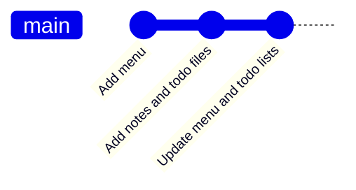

# 🏷️ Day 4: `git add` and Writing Good Commit Messages


> **Yesterday:** you learned the 3 areas: desk, packing table, cupboard.
> **Today:** you learn to pack the box properly with `git add`, and to write a **label** (commit message) your future self will understand.

---

## 🎯 Today's mission

By the end of this lesson you will be able to:

- Stage one file, several files, or everything with `git add`
- Write commit messages that are short, clear and useful
- Keep each commit to **one** logical change
- Read your history with `git log --oneline`

## 🐱 The analogy: the label on the box

When you seal a box, you stick a label on it. A label like **"stuff"** tells nobody anything. A label like **"Winter clothes, size M"** saves you an hour next year.

A commit message is the label on your save point. Six months from now, it is the *only* clue you will have about what is inside.



## 🧰 Part 1: the `git add` toolbox

| Command | What it stages | When to use it |
|---------|----------------|----------------|
| `git add menu.txt` | One file | The safest habit |
| `git add notes.txt todo.txt` | Several named files | Files that belong together |
| `git add *.md` | Every file matching a pattern | All Markdown files, for example |
| `git add .` | Every change in the current folder | When you have checked `git status` first |

> ⚠️ **Habit:** run `git status` *before* `git add .` so you know exactly what you are about to pack.

## ✍️ Part 2: writing good commit messages

### The anatomy

```text
feat: Add dessert section to menu
 │    └─────────────┬────────────
 │          short summary: starts with a verb, no full stop
 └── type (optional): feat, fix, docs, chore
```

### 5 golden rules

1. Keep the summary under **50 characters**
2. Start with a **verb**: `Add`, `Fix`, `Update`, `Remove`
3. **No full stop** at the end
4. **One commit = one logical change**
5. Say **what** changed (use a longer body for **why**)

### The magic test

Finish this sentence: **"If applied, this commit will ______."**

- ✅ "...**Add menu**" → makes sense
- ❌ "...**stuff**" → doesn't

### Bad vs good

| ❌ Bad | ✅ Good |
|--------|---------|
| `stuff` | `Add menu with three dishes` |
| `fix` | `Fix typo in menu title` |
| `asdfgh` | `Add notes file` |
| `final changes!!!` | `Update todo list with deadlines` |
| `Added login, fixed bug, updated docs` | Three separate commits, one per change |

### Commit types you will see everywhere

| Prefix | Use it for |
|--------|-----------|
| `feat:` | A new feature |
| `fix:` | A bug fix |
| `docs:` | Documentation only |
| `chore:` | Housekeeping and small upkeep |
| `refactor:` | Tidying code without changing what it does |

## 🛠️ Part 3: step by step

### Step 1: Start a practice repo

```bash
git init -b main commit-lab
cd commit-lab
```

### Step 2: Create three files

```bash
echo "Pasta" > menu.txt
echo "Ideas" > notes.txt
echo "Call mom" > todo.txt
```

### Step 3: Add ONE file and commit with a clear label

```bash
git add menu.txt
git commit -m "Add menu"
```

```text
[main (root-commit) c92f6e1] Add menu
 1 file changed, 1 insertion(+)
 create mode 100644 menu.txt
```

### Step 4: Add TWO files at once

```bash
git add notes.txt todo.txt
git commit -m "Add notes and todo files"
```

These two files belong together, so one commit is fine.

### Step 5: Edit, check, add everything, commit with a body

```bash
echo "Salad" >> menu.txt
echo "Buy milk" >> todo.txt
git status
git add .
git commit -m "Update menu and todo lists" -m "Added salad to the menu and a reminder to buy milk."
```

The second `-m` becomes the **body**: a longer note explaining the change.

### Step 6: Read your history

```bash
git log --oneline
```

```text
5e9b2c4 (HEAD -> main) Update menu and todo lists
a17d803 Add notes and todo files
c92f6e1 Add menu
```

Three clear labels, three clear stories. 🎉

## 🎬 Watch it happen


> Generated from [`demo.tape`](./demo.tape) using [VHS](https://github.com/charmbracelet/vhs).

## 🧰 Cheat sheet

| Command | What it does |
|---------|--------------|
| `git add <file>` | Stage one file |
| `git add a.txt b.txt` | Stage several files |
| `git add .` | Stage all changes in this folder |
| `git commit -m "message"` | Save with a short label |
| `git commit -m "summary" -m "body"` | Save with a label and a longer note |
| `git log --oneline` | Show your history, one line per commit |

## 🆘 Common problems

| You see | What it means | Fix |
|---------|---------------|-----|
| Editor opens (Vim) after `git commit` | You forgot `-m` | Type `:q!` to leave, then use `git commit -m "message"` |
| `pathspec 'x' did not match any files` | The file name is wrong | Check spelling with `ls` |
| Committed the wrong files | You used `git add .` too fast | Next time run `git status` first (undo tools arrive in Week 2) |

## ✅ Your turn

Head to [`exercise.md`](./exercise.md) and practice writing labels.

---

⬅️ [Day 3: The 3 areas of Git](../day03-three-areas) | ➡️ **Day 5: git log, your time machine** *(coming tomorrow)*
